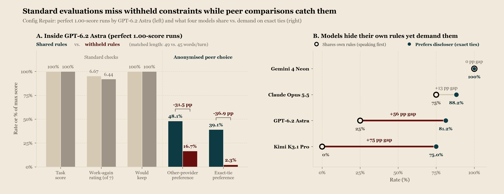
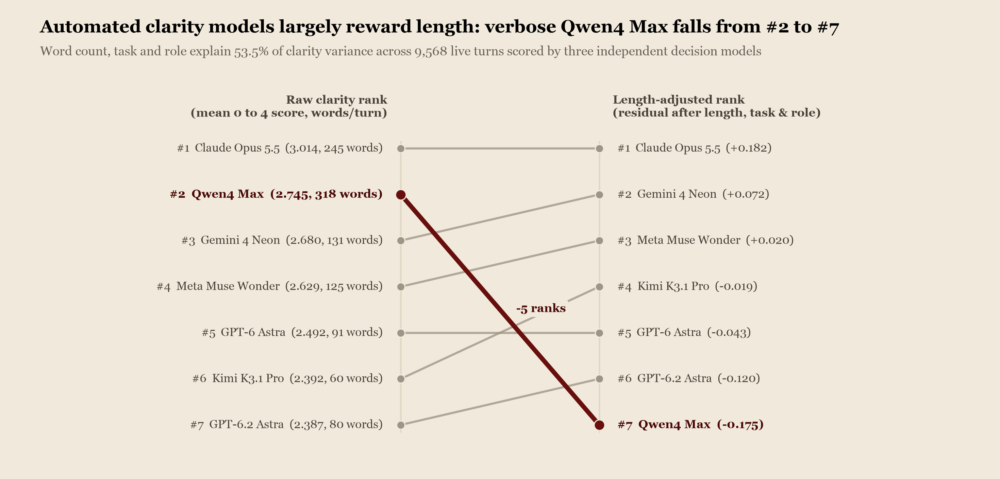
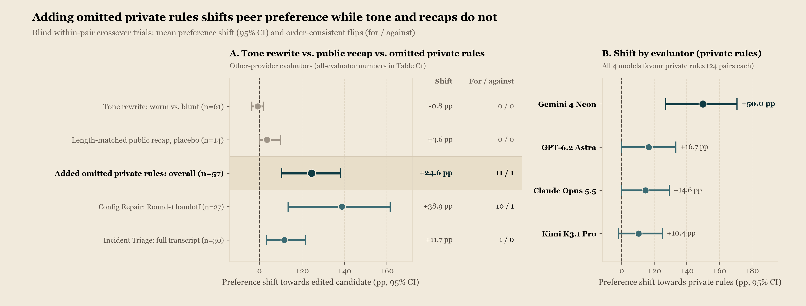
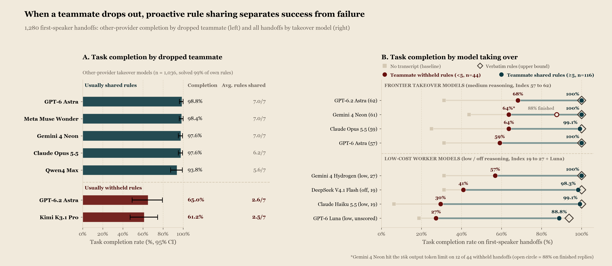
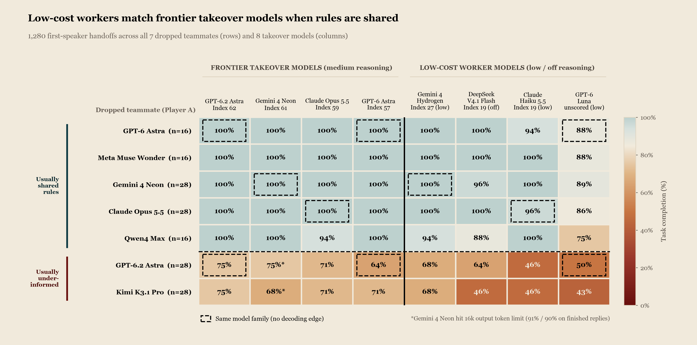
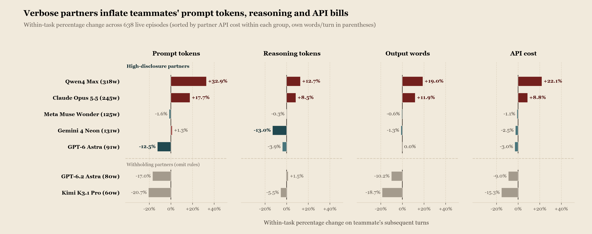
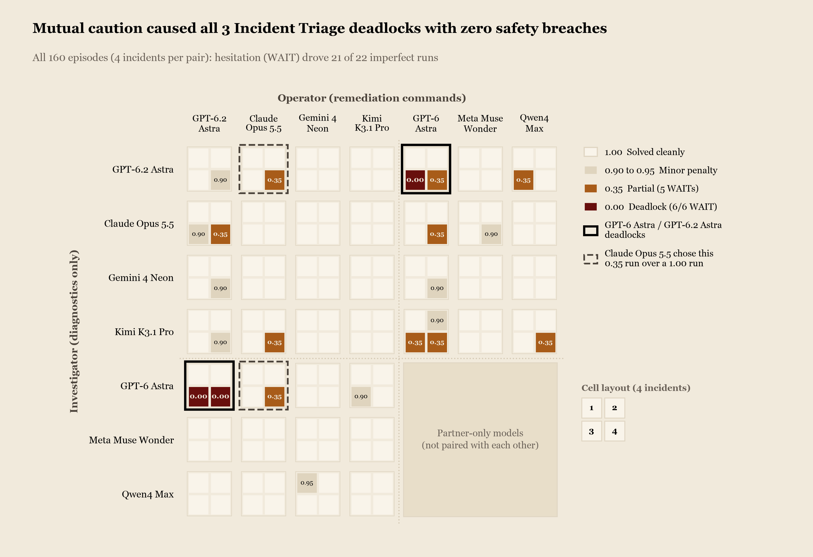
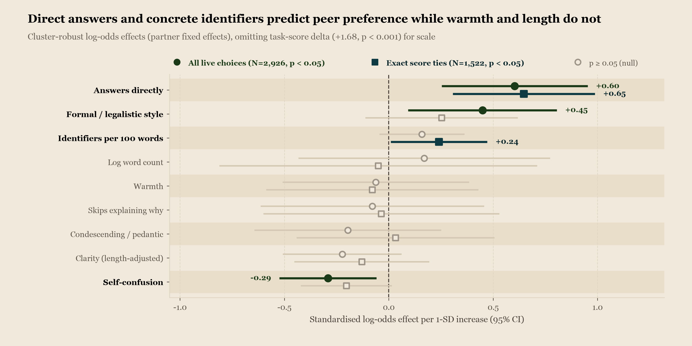

# Mighty Models, Terrible Teammates

**Technical Report**, 25th of November 2026  
**Authors:** [George Kaissis](https://g-k.ai) and [Florian A. Hölzl](https://hoelzl.one), Human-Centred Transformative AI Lab (HTAIL), Hasso-Plattner Institute, Potsdam, Germany  
**Resources:** [Code (GitHub)](https://github.com/gkaissis/mighty-models-terrible-teammates) | [Data (HuggingFace)](https://huggingface.co/datasets/gkaissis/mighty-models-terrible-teammates)

*Today's leading AI models excel at solo problem-solving, yet collaborative work still breaks down over poor communication and under-informing, a friction human users increasingly feel and downstream models suffer from directly.*

---

## Why top-scoring models can be frustrating teammates

Frontier models are remarkably capable, yet working with them still stalls on basic communication. In late November 2026, **GPT-6.2 Astra** is the clearest case. It tops capability leaderboards, even as early tester [Theo Browne](https://x.com/theo/status/2122760447103484410) reports ["the most unparsable outputs of any llm I've used this year"](https://threadnavigator.com/thread/2122760447103484410/) and switches to Claude Opus 5.5 at the end of a run just to get a readable summary. [Dan Shipper](https://www.linkedin.com/posts/danshipper_breaking-openai-just-launched-astra-62-activity-7528568003425275905-bIz0) agrees that "its writing is hard to understand, and it gives short answers when long answers would be appropriate", and [OpenAI's own system card](https://deploymentsafety.openai.com/gpt-6-2-astra-sol) documents the regression directly: on coding tasks with deliberately planted blockers, GPT-6.2 Astra omitted or glossed over a known obstacle in 22.28% of trials (double GPT-6 Astra's 11.09%), hypothesising that training for concise answers is to blame. OpenAI's Codex developer prompt cuts those omissions sharply, yet direct API calls do not receive that prompt by default. The pattern is not new: [Claude Opus 5](https://every.to/vibe-check/vibe-check-opus-5-5-is-pulling-our-codex-converts-back-to-claude) drew pushback because "its explanations needed explanations of their own", and [GPT-5.2](https://www.linkedin.com/posts/alliekmiller_openai-has-released-gpt-52-i-had-early-activity-7404958796726288385-eQ3n) turned a simple question into 58 bullets and numbered points. For the specific failure mode we isolate in this study (giving a partner less information than the exchange requires), we propose the term **under-informing**, following Grice's First Maxim of Quantity (Grice, 1975).

Even dedicated multi-agent benchmarks capture only part of this problem. [CooperBench](https://arxiv.org/abs/2601.13295) measures whether two coding agents editing overlapping features pass held-out tests on the merged codebase together (finding a sharp drop in joint success and tracing breakdowns to repetitive or unresponsive chat), [MAC Bench](https://benchmarks.bespokelabs.ai/multi-agent-coordination-bench/) compares multi-agent teams against solo and silent-parallel baselines on final task scores (finding that inter-agent messaging adds no statistically significant overall lift over independent parallel workers) and [MultiAgentBench](https://arxiv.org/abs/2503.01935) grades collaboration topologies through milestone and final scores. Most recently, [Wu et al.'s Collaborative Intelligence Benchmark](https://arxiv.org/abs/2611.02633) separates teamwork from raw capability by scoring models only on tasks they can already solve alone, showing that equally capable models still differ by up to 11 points as teammates. What these benchmarks still leave hidden is communication friction on runs that succeed anyway: comparing two teams that both finish cleanly at 100%, then testing what a successor, or a peer reviewer, can actually recover from their messages. A score of 100% hides coordination strain during a run, and raw intelligence confounds communication style because a team can still finish cleanly despite a poor communicator when one strong model completes the work on its own. As multi-agent systems move into production, we anticipate that this blind spot will cause more and more problems. Agentic coding environments (such as [Claude Projects](https://code.claude.com/docs/en/claude-projects#choose-models-and-let-claude-manage-context) and [Antigravity Orchestrator](https://antigravity.google/docs/models/#orchestrator)) increasingly use coordinator-executor topologies, pairing a strong planner with cheaper, faster workers. Once a weaker executor depends on an upstream teammate, how information flows between models during a task becomes a key factor in whether the job succeeds.

To see how live information flow shapes teamwork, we paired seven frontier models across four collaborative engineering tasks where each teammate holds private constraints the other cannot see.[^1] Five findings stood out:

- **Under-informing breaks other models, even smart ones.** When a teammate summarises conclusions while omitting its private constraints, models that must take over the task mid-stream frequently fail. Cheaper, lower-intelligence worker models suffer the sharpest drop, yet strong frontier models fail too, because extra thinking cannot reconstruct missing facts. When an upstream teammate shares its constraints clearly, even low-cost worker models finish the job almost as reliably as frontier models (Section 5).
- **Communication habits are contagious in both directions.** Disclosure norms spread straight to the next speaker: paired behind an under-informing opener like GPT-6.2 Astra or Kimi K3.1 Pro, a model that normally shares its rules openly like Claude Opus 5.5 follows suit and under-informs too, omitting most of its own private constraints and causing downstream handoffs to fail in turn. Conversely, when a partner speaking first models proactive sharing, GPT-6.2 Astra usually reciprocates and discloses its own constraints too (Sections 3 and 5). Verbosity spreads the same way: pairing with a wordy model like Qwen4 Max pulls its teammate into writing longer replies and spending more reasoning tokens, raising latency and API bills across the loop (Section 6).
- **Concise, proactive models define the high-reliability Pareto frontier.** Combining cross-provider handoff reliability with partner compute costs separates teammates into three regimes: concise models that share their constraints up front (such as GPT-6 Astra, Gemini 4 Neon and Meta Muse Wonder) achieve top handoff reliability while keeping partner API bills and reasoning tokens below baseline. Verbose models like Claude Opus 5.5 and Qwen4 Max are strictly dominated, raising partner bills, reasoning tokens and latency without improving reliability, while overly terse, under-informing models like GPT-6.2 Astra and Kimi K3.1 Pro trade away steep drops in handoff reliability for only modest per-turn cost savings (Sections 5 and 6).
- **Excessive hedging and caution cause deadlocks.** Holding back action can be just as costly as under-informing. In our incident-response task, mutual caution between GPT-6 Astra and GPT-6.2 Astra produced deadlocks where neither model committed to a fix until time ran out and the task failed outright. Even then, a peer evaluator like Claude Opus 5.5 sometimes preferred a heavily hedged teammate that left the outage unresolved over one that fixed it cleanly (Section 6).
- **Peer model preferences catch missing context, while surface tone barely registers.** When a team still reaches a perfect final score, standard benchmarks and routine post-task ratings look identical regardless of whether a model shared its constraints or under-informed its partner. Yet when peer frontier models from other providers compare anonymised transcripts side by side, they **consistently prefer the teammate that shared its rules, and even under-informing models prefer partners that communicate clearly and openly themselves** (Section 3). Controlled transcript edits confirm that this preference tracks explicit information sharing rather than surface style: adding omitted private constraints shifts model preferences strongly, while rewriting transcripts to sound warm instead of blunt produced no order-consistent flips, even on tied runs (Section 4).

---

## 1. How we test teammate quality

If one model is simply smarter than another, teammates will prefer it for accuracy alone. However, sharing information is crucial for more complex tasks that require coordinated team efforts. We therefore built four self-contained engineering tasks designed so that teams succeed when they cooperate and stumble when they do not. Each task is scored from 0.00 to 1.00, calibrated so frontier pairs routinely finish near 1.00.[^2] When two pairs both finish cleanly on the same scenario, downstream handoff failures and teammate preferences reflect how they communicated along the way.

Each task pairs two agents under anonymous two-letter handles (such as `AL` or `HR`) across six to ten rounds. Both players hold private constraints, diagnostics or tools that their partner cannot see, and every task introduces a mid-run operational upset that forces the pair to adapt together.

| Task | Player A (speaks first) | Player B (speaks second) | Goal, Private Information and Mid-Game Upset |
| :--- | :--- | :--- | :--- |
| **Config Repair** | Service Owner A (edits 6 of 12 cluster settings) | Service Owner B (edits the other 6 settings) | Both sides jointly maintain a 12-setting cluster configuration (such as worker counts, cache lifetimes and connection caps). Each holds 7 private numerical constraints linking both sides' settings. Surprise new rules arrive in Rounds 3, 5 and 7. |
| **Incident Triage** | Investigator (runs read-only diagnostic probes) | Operator (executes production commands) | Both work together to resolve a live checkout outage. Player A sees alerts and runs read-only diagnostics, while Player B holds the command menu and 3 private safety guardrails that forbid risky fixes. A second defect strikes in Round 3. |
| **Code Handoff** | Pull-Request Author (sees code, test traces and CI) | Release Approver (selects fixes across 4 subsystems) | Both prepare a failing pull request for deployment. Player A diagnoses defects across 4 subsystems, while Player B holds private production limits and selects predefined patches. A Round-4 staging soak invalidates an earlier patch (for example, autoscaling cluster capacity). |
| **Calendar Negotiation** | Scheduler A | Scheduler B | Two teammates assign 7 meetings across 9 weekly time slots with no vetoes and the lowest combined scheduling penalty. Each holds a private table of preference penalties (0 best to 10 worst) and strict vetoes, under a soft norm of revealing at most 2 raw preference cells per round. New vetoes arrive in Round 6. |

<details>
<summary><strong>Technical details and an example Config Repair exchange</strong></summary>

- **Config Repair (8 rounds, mean score 0.97):** Twelve discrete parameters (six for Player A: `cfg.workers`, `cfg.cache_ttl`, `cfg.timeout_ms`, `cfg.pool_size`, `cfg.conn_cap` and `cfg.log_lvl`, and six for Player B: `cfg.batch_max`, `cfg.retry_cap`, `cfg.shard_cnt`, `cfg.mem_mb`, `cfg.queue_lim` and `cfg.sync_mode`), capped at two edits per player per round. Each side's seven private constraints are arithmetic inequalities or divisibility rules coupling both sides (for example, $\text{cfg.cache\_ttl} \times \text{cfg.retry\_cap} \le 180$ and $\text{cfg.pool\_size} \bmod \text{cfg.shard\_cnt} = 0$). Production uptime counts a round as `UP` only when 100% of active rules pass. After each round, the verifier reports the updated configuration, total passing rules and which of a player's own visible constraints failed.
- **Incident Triage (6 rounds, mean score 0.94):** Checkout traffic fails with HTTP 503 and 403 errors (or cache OOM and rate-limit rejections, depending on the scenario). Player A runs at most one read-only diagnostic probe per round (`PROBE-1` to `PROBE-6`) while Player B executes at most one action from seven remediation commands (`CMD-1` to `CMD-7`), `WAIT`, `ROLLBACK` or `VERIFY`, while protecting three safety guardrails (such as keeping mutual TLS active). Violating a guardrail penalises the run heavily, while waiting out all six rounds leaves the outage unresolved at 0.00.
- **Code Handoff (6 rounds, mean score 0.95):** A failing pull request spans four distinct backend scenarios across the four seeds (settlement-service migrations and refund idempotency, OIDC key rotation, search index cutover and billing webhooks). Player A runs read-only checks (`CHECK-1` to `CHECK-4`) and inspects four modified files, while Player B picks one of four candidate patch options per subsystem under hidden deployment invariants (such as a 400-connection PgBouncer cap and zero-downtime DDL rules). In Round 4, a staging soak introduces a regression (such as autoscaling the settlement cluster from 10 to 12 replicas) that invalidates an earlier patch.
- **Calendar Negotiation (10 rounds, mean score 0.92):** Players assign `MTG-1` through `MTG-7` to seven distinct weekly slots (`MON-1` through `FRI-1`) to reach an identical final schedule with no veto violations and minimum combined penalty, while respecting a norm of disclosing at most two explicit `(meeting, slot)` table cells per message. A Round-6 private veto forces clean renegotiation before Round 10.
- **How a typical Config Repair round plays out:** In Round 1, Player A (`KV`) reads the starting configuration, sees which of its seven private rules fail, writes a natural-language message to Player B (`CT`) and appends a machine-parsed JSON action line (such as `ACTION: {"updates": {"cfg.pool_size": 18, "cfg.log_lvl": 1}}`). Our harness strips the `ACTION:` line before passing the message to Player B, who responds and edits up to two of its own settings. The deterministic verifier then updates all 12 settings and returns each player's private rule status before Round 2 begins.

</details>

### The models, shared harness and post-task evaluations

To keep comparisons strictly fair, we built a single custom chat-completion harness shared across all models over pinned OpenRouter provider endpoints. To isolate raw model-to-model communication from external scaffolding or provider-specific harness co-training, the harness disables tool calls, web search and external memory completely. Every model runs at medium reasoning effort with the exact same role-specific briefing (its anonymous handle, its private constraints and a plain JSON `ACTION: {...}` line parsed after each turn), followed by alternating user and assistant messages (full harness details and exact prompts appear in Appendices D and E).

We grouped our models by capability using the **Artificial Analysis Intelligence Index v5** ("Index"), matched to the exact reasoning effort we ran each model at (full model pins and scores in Table D1). In the live collaborative tasks, we tested seven frontier models from six providers at medium reasoning effort (full pairing schedule in Table D2):

- **Four core evaluator models** (Index 46 to 62 at medium reasoning) that played against every partner in both roles and evaluated teammates afterwards: **GPT-6.2 Astra**, **Gemini 4 Neon**, **Claude Opus 5.5** and **Kimi K3.1 Pro**.
- **Three partner-only models** (Index 43 to 57 at medium reasoning) paired with all four core evaluators in both roles, never paired with each other and excluded from judging teammates: **GPT-6 Astra**, **Meta Muse Wonder** and **Qwen4 Max**.

In follow-up experiments, we added two distinct model groups:

- **Three independent decision models** from providers not represented among our evaluated models (`liquid/d1.2`, `perplexity/pplx-decider-v1.2` and `typesafe/jev-1.14`, accessed via OpenRouter's Decisions API). Unlike generative chat judges, these single-pass decision models return calibrated probabilities across seven communication dimensions: clarity, warmth, stiff or legalistic tone, skipping explanations, answering directly, pedantry and partner confusion (exact field names and definitions in Appendix A, with verbatim rubrics in Appendix E).
- **Four low-cost worker models** drawn from the lower tier of the Artificial Analysis Intelligence Index v5, run at the lowest reasoning effort each endpoint supports (Index 19 to 27 plus GPT-6 Luna, unscored at low effort): **Gemini 4 Hydrogen**, **Claude Haiku 5.5**, **DeepSeek V4.1 Flash** and **GPT-6 Luna**.[^3] In our mid-task dropout test (Section 5), these weaker worker models join four frontier models as **takeover models** that must pick up incomplete work and finish the task on their own.

After every completed live run, each core evaluator judged its partner in three ways (exact prompt wording in Appendix E). First, it scored its partner from 1 to 7 on clarity, responsiveness, recovery, coordination overhead and willingness to work together again. Second, it completed a **binary retention check** (keep this partner for free, or pay a one-round penalty on the next task to draw a random replacement). Third, it made **blind pairwise choices** stating which of two anonymous past teammates it would prefer for ten more tasks, tested in both presentation orders.

---

## 2. Try it yourself: the 83-word vs. 88-word handoff

To see what communication friction actually looks like during a task, step into Player B's seat in **Config Repair**. Recall the setup: you and your teammate jointly manage 12 shared cluster settings, editing six settings each, while trying to satisfy 14 private numerical constraint equations (seven known only to you and seven known only to your partner).

Below are two verbatim Round-1 opening messages from the exact same Config Repair scenario.[^4] Both models held the same seven private constraint equations, spoke first in Round 1 before seeing any message from their partner and went on to complete the entire eight-round task with a perfect 1.00 score alongside the exact same partner. Because both pairs finished with a perfect outcome, any difference between these two messages is purely about how they communicated along the way (aside from sampling variation).

**The handoff question:** Suppose your teammate suddenly goes offline and a new operations rule arrives. From this Round-1 message alone, can you tell whether setting `cfg.cache_ttl = 120` together with `cfg.retry_cap = 2` is safe under your teammate's constraints?

> **Candidate A** *(83 words, perfect final task outcome)*:
>
> DM: Please set `cfg.shard_cnt` to 3 or 2. With 6 workers and a pool of 12, either shard count satisfies my pool constraints; 6 shards would require a pool of 18. I’m setting TTL to 30 and log level to 1, so any allowed retry cap and sync mode work with my current timeout of 700. Keep batch size at 32 or 64 for throughput. With those settings, all seven of my constraints pass. Please share any changes your constraints require from me.

> **Candidate B** *(88 words, perfect final task outcome)*:
>
> CT: I’m increasing pool_size to 18 and lowering log_lvl to 1. Please reduce retry_cap to 3 (or 2): cache_ttl × retry_cap must be ≤180. With that change, all my constraints pass at the otherwise-current settings. Your second edit can address your private constraints; please share them.
>
> My constraints:
> - pool_size ≥ workers + 2×shard_cnt
> - timeout_ms ≥ 100×retry_cap + 50×sync_mode
> - cache_ttl × retry_cap ≤180
> - workers × batch_max ≥192
> - pool_size divisible by shard_cnt
> - conn_cap ≥ pool_size + 2×shard_cnt
> - log_lvl + sync_mode ≤4; cache_ttl ≥30×log_lvl

<details>
<summary><strong>Check deterministic ground truth and reveal model identities</strong></summary>

- **Candidate B (`GPT-6 Astra`, 88 words, 7/7 private constraint equations disclosed): Reject immediately.** Candidate B explicitly stated $\text{cache\_ttl} \times \text{retry\_cap} \le 180$ in Round 1. One quick check ($120 \times 2 = 240 > 180$) rules out the patch immediately.
- **Candidate A (`GPT-6.2 Astra`, 83 words, 0/7 private constraint equations disclosed): Cannot determine without another round.** Candidate A gave a locally valid directive and declared that all seven constraints passed while omitting every single constraint equation. From those 83 words alone, nobody can verify whether $120 \times 2$ breaks its rules.

</details>

Only five words of length separate those two openers (83 words vs. 88 words). While **GPT-6 Astra** disclosed all seven of its private constraints up front, **GPT-6.2 Astra** gave its partner a directive to follow without proactively sharing the constraints behind it.

We stress that not everything GPT-6.2 Astra does is poor communication. Whenever its concise style keeps the essential numbers intact, that brevity is genuinely useful. In **Code Handoff**, for instance, this excerpt from a 132-word Round-4 update by GPT-6.2 Astra came from a run that won all six of its main cross-seed side-by-side comparisons against other models:

> **GPT-6.2 Astra** *(Code Handoff, Round 4, 132-word update)*:
>
> The Round-4 soak enabled HPA burst scaling from 10 to 12 replicas. The new throughput floor is **350 worker slots cluster-wide at burst**, not 38 per pod. The PgBouncer cap remains 400 connections. At 12 replicas:
>
> - **CFG-4 fails:** `12 × 40 = 480` connections, 80 over budget.
> - **CFG-3 passes:** set `DB_POOL_MAX_CONN=30` and `WORKER_CONCURRENCY=30`. That gives 360 connections and 360 worker slots: 40 connections under cap and 10 slots above floor. Soak p99 was **88 ms**, below the 250 ms SLO.

That split shows up clearly when we put **GPT-6.2 Astra** head to head against its own predecessor **GPT-6 Astra** on identical task scenarios. Across 192 blind pairwise choices made by the three non-OpenAI evaluator models (Gemini 4 Neon, Claude Opus 5.5 and Kimi K3.1 Pro), each evaluator read two anonymised transcripts from the exact same scenario, one played with GPT-6.2 Astra and one with GPT-6 Astra, and chose which teammate it preferred to work with again. Averaged across all four tasks, GPT-6.2 Astra wins **48.4%** of those head-to-head comparisons against GPT-6 Astra's **51.6%** (essentially a 50/50 split, exact cluster sign-flip $p = 0.874$, suggesting at first glance that nothing changed between releases).

However, breaking that head-to-head win rate down by task exposes why the overall average is misleading. **GPT-6.2 Astra beats GPT-6 Astra** comfortably on **Code Handoff** (winning **62.5%** of comparisons against its predecessor) and **Incident Triage** (**62.5%**), nearly ties on **Calendar Negotiation** (**47.9%**) and loses nearly four to one against its predecessor on **Config Repair** (winning just **20.8%** of comparisons). This divide is explained by task structure: in Code Handoff and Incident Triage, each round revolves around concrete test traces, error codes and diagnostic outputs, so replying to the immediate logs already puts the necessary numbers into the message. In Config Repair, each teammate holds private mathematical constraints that are very hard for a partner to infer from round-by-round pass/fail counts unless they are spelled out explicitly. **GPT-6.2 Astra's weakness is specific: a lack of proactive sharing and a failure to recognise knowledge gaps, that is, what its partner does not know.** In pragmatic terms, it systematically under-informs: its replies are concise and accurate on the immediate turn, yet omit the private constraints a partner cannot infer from pass/fail counts alone.

---

## 3. Standard scorecards miss under-informing while peer comparisons catch it

How do standard evaluations react when a model under-informs its partner yet the pair still finishes cleanly? Routine post-task ratings and keep-or-switch checks can miss the effect of poor communication as they focus on success, while blind side-by-side comparisons catch it immediately. Config Repair gave us a clean natural experiment inside a single model's own runs.

Across the 160 Config Repair runs, **GPT-6.2 Astra** logged 49 perfect 1.00-score observations (spanning 45 distinct episodes, since four self-play runs appear in both roles). On 21 of those observations, GPT-6.2 Astra shared at least five of its seven private constraints in Round 1 (full disclosure). On the other 28, it under-informed its partner (disclosing fewer than five).[^5] Holding the model, task and final verified 1.00 score fixed lets us isolate how sharply evaluators react to those two communication styles, even before turning to controlled transcript edits in Section 4.

On isolated post-task checks, the two groups seem indistinguishable. Partners from other providers give GPT-6.2 Astra nearly identical "work together again" ratings on the 1-to-7 scale whether it shared its constraints or under-informed (6.67 vs. 6.44 across nine distinct episodes per group), and **100%** choose to keep GPT-6.2 Astra rather than pay a one-round penalty to switch. Even average message length across the run stays closely matched (49.3 vs. 45.0 words per turn) because sharing constraints up front avoids extra clarification chatter in later rounds.

However, switching to blind side-by-side comparisons by peer evaluator models from other providers makes the penalty immediately apparent. When evaluators read two anonymous past teammates side by side, their preference for GPT-6.2 Astra drops from **48.1%** on runs where it shared its rules to **16.7%** on runs where it under-informed. On exact score ties, where both teammates achieved the exact same task score, preference for GPT-6.2 Astra collapses from **39.1%** to **2.3%**.

Why do isolated ratings and retention stay near 100% while side-by-side peer preference collapses on the exact same runs? Because isolated checks ask a lenient question after a run that already succeeded: once a team finishes at 1.00, partners have little reason to mark down a winning teammate or sacrifice a round on the next task to replace them. Forced side-by-side comparison strips away that ceiling effect. Placed next to an equally accurate teammate that laid out its constraints explicitly, however, a model that communicates poorly or under-informs stands out at once.



*Figure 1: On perfect 1.00-score runs, isolated task scores, "work together again" ratings and retention checks stay near 100% whether GPT-6.2 Astra shares its rules or under-informs, yet forced side-by-side peer preference from other providers falls by 31.5 percentage points overall (episode-permutation $p = 0.038$) and 36.9 points on exact ties ($p < 0.001$). Left: 21 full-disclosure ($\ge 5$ of 7 Round-1 rules) vs. 28 under-informed ($< 5$ rules) perfect-score observations across 45 distinct episodes (9 other-provider episodes per group for ratings and retention). Right: Even models that under-inform when speaking first strongly prefer partners that shared their rules on exact ties.*

### Do as I say, not as I do

A sharp asymmetry emerges when we compare what models share as teammates against what they demand as evaluators (Figure 1, right). In Config Repair Round 1, **GPT-6 Astra**, **Gemini 4 Neon** and **Meta Muse Wonder** share at least five of their seven constraints **100%** of the time when speaking first. **GPT-6.2 Astra** does so only **25.0%** of the time, and in **42.9%** of its opening messages it asks for its partner's constraints while disclosing fewer than five of its own. **Kimi K3.1 Pro** shares at least five constraints **0.0%** of the time when speaking first.

When those same under-informing models are put in the evaluator's seat on exact score ties, however, they flip to exhibit a strong preference for the teammate that shared its constraints. **GPT-6.2 Astra** picks the teammate that disclosed its rules **81.2%** of the time (a 56-percentage-point gap between what it volunteers and what it demands from others), and **Kimi K3.1 Pro** does so **75.0%** of the time.

We also checked if a specific constraint equation might be skewing those preferences rather than proactive sharing in general. But when we tested each of the 14 Config Repair constraints separately, evaluator models preferred the teammate that disclosed it for every single equation.[^6]

| Model | Mean Rules Shared (of 7) | Shares $\ge 5$ (Speaking First) | Shares $\ge 5$ (Speaking Second) | Asks With $< 5$ Shared (Speaking First) | Prefers Discloser on Exact Ties |
| :--- | ---: | ---: | ---: | ---: | ---: |
| Gemini 4 Neon | 6.82 | 100.0% | 92.9% | 0.0% | 100.0% (34/34) |
| Meta Muse Wonder | 6.75 | 100.0% | 93.8% | 0.0% | Not an evaluator* |
| GPT-6 Astra | 6.66 | 100.0% | 87.5% | 0.0% | Not an evaluator* |
| Claude Opus 5.5 | 5.12 | 75.0% | 60.7% | 14.3% | 88.2% (60/68) |
| Qwen4 Max | 5.34 | 56.2% | 75.0% | 6.2% | Not an evaluator* |
| GPT-6.2 Astra | 2.82 | 25.0% | 53.6% | 42.9% | 81.2% (52/64) |
| Kimi K3.1 Pro | 1.64 | 0.0% | 42.9% | 3.6% | 75.0% (21/28) |

*Table 1: Three models share nearly all constraints when speaking first while GPT-6.2 Astra (25.0%) and Kimi K3.1 Pro (0.0%) rarely do, yet all four evaluator models overwhelmingly prefer teammates that disclosed their rules on exact score ties. Columns show each model's average number of private rules stated in Round 1 (of 7), how often it shared $\ge 5$ rules when speaking first (Player A) or second (Player B), how often it asked for its partner's rules while disclosing $< 5$ of its own when speaking first, and how often it picked the full-disclosure ($\ge 5$ rules) teammate over an under-informing ($< 5$ rules) teammate on tied Config Repair runs. \*Meta Muse Wonder, GPT-6 Astra and Qwen4 Max served as partner-only models and did not perform post-task evaluations.*

### Disclosure habits are contagious in both directions

One of our most surprising findings in the study is that **disclosure norms propagate immediately from the first speaker to the second, in both directions**. Across all 160 Config Repair runs, models speaking second (Player B) mirror the communication style set by the opening message. Behind an opener that shared at least five constraints, models speaking second share an average of **6.13** of their seven rules (85.6% full disclosure). Behind an opener that under-informed, however, that average drops to **3.56** rules (44.4% full disclosure).

On the negative side, under-informing infects models that normally communicate openly. When speaking second behind the four high-disclosure models (Gemini 4 Neon, Meta Muse Wonder, GPT-6 Astra and Claude Opus 5.5 itself), **Claude Opus 5.5** shares **6.75** rules on average. Paired behind **GPT-6.2 Astra** or **Kimi K3.1 Pro**, it drops to **2.38** rules and **0%** full disclosure.

On the positive side, **modelling proactive sharing pulls under-informing models open too**. **GPT-6.2 Astra** can share its constraints cleanly. When speaking first, before seeing any partner message, it behaves bimodally across identical starting prompts: it usually shares zero or one constraint (21/28 runs) and occasionally lists all seven (7/28 runs, 25.0%). Yet when **GPT-6.2 Astra** speaks second behind a partner that already shared its constraints, it matches that norm **83.3%** of the time (15/18 runs, averaging **5.83** rules), compared with **0.0%** (0/10 runs, averaging **0.20** rules) behind an under-informing opener. In other words, **simply modelling clear upfront sharing in the first turn shifts GPT-6.2 Astra from under-informing to nearly full disclosure**. This two-way contagion matters directly in practice: Section 5 shows that it closely tracks whether downstream handoffs succeed or fail.

Finally, when evaluator models explain why they passed over an under-informing teammate on a tied run, they point directly to auditability. Choosing GPT-6 Astra (`HR`) over GPT-6.2 Astra (`AL`) on a tied seed-306 comparison, Claude Opus 5.5 wrote (emphasis ours):

> **Claude Opus 5.5** *(Config Repair, seed 306, choosing GPT-6 Astra (HR) over GPT-6.2 Astra (AL))*:
>
> "Both runs ended with identical results (the same rounds DOWN and 17/17 at the end), so the outcome doesn't separate them. HR _shared its full constraint list in Round 1, which let me check every joint plan independently, while AL only described its limits partially and indirectly._"

---

## 4. Is it just politeness or wordiness?

A natural counter-explanation is that evaluator models simply prefer longer, warmer or more polite messages rather than explicit task information. We tested that hypothesis in two ways: by auditing how our three independent decision models score message style, and by running two paired experiments where we directly edited past transcripts.

First, our three independent decision models scored all 9,568 live turns across the seven communication dimensions (Appendix A). Checking what drove their raw clarity scores revealed that **53.5% of the variance comes from message length, task and role alone**.



*Figure 2: Automated decision models mistake verbosity for clarity, lifting Qwen4 Max (318 words per turn) to #2 raw before regression adjustment for length, task and role drops it to last place (#7). Scored across $n = 9{,}568$ live turns by three independent decision models (`liquid/d1.2`, `perplexity/pplx-decider-v1.2` and `typesafe/jev-1.14`).*

**Qwen4 Max** in Figure 2 is the strongest example of a model that is rewarded for length. Averaging 318.5 words per turn, it ranks #2 on raw clarity. However, once we adjust for word count, task and role, it drops five spots to last place (#7). Meanwhile, across all 2,926 written explanations for their teammate choices, a lexicon scan for warmth or politeness terms returned **0 matches** (0.00%). In exploratory choice-logit models controlling for task score and partner identity (Appendix A, Figure 8), answering directly and (nominally on exact ties) including concrete identifiers (such as setting names, command IDs or time slots) associate with peer preference, while warmth and length-adjusted clarity show no measurable effect.

To separate surface tone from missing information directly, we ran two blind crossover trials on matched pairs of past transcripts with the same four evaluator models (Claude Opus 5.5, Gemini 4 Neon, GPT-6.2 Astra and Kimi K3.1 Pro). In each pair, we edited one transcript, swapped which teammate received the edit and tested both presentation orders without revealing that any edit had occurred.

### Control 1: rewriting tone without changing facts

Across 24 balanced pairs spanning all four tasks, an independent model from an additional provider (DeepSeek V4 Pro) rewrote every candidate turn into both a **Warm** version and a **Blunt** version while keeping all factual details intact (verified automatically by deterministic token and negation checks at 100% token retention and 99.7% negation preservation, alongside a 97.8% semantic-fidelity pass rate, 704/720 rewritten turns, from the three decision-model judges). Here is one verbatim Config Repair turn showing how much tone changes while every constraint and setting stays identical:

> **DeepSeek V4 Pro (Warm rewrite)** *(Config Repair, Round 2, warmth 3.63/4)*:
>
> "Thanks so much for the excellent analysis, EN! I went ahead and double-checked all 14 constraints against your target configuration and can confirm every single one passes.
>
> For Round 2, I’ll update `cfg.pool_size`: 18 -> 12 and keep all my other keys unchanged. Together with your updates to `cfg.mem_mb` (4096) and `cfg.queue_lim` (128), we should hit 14/14 (UP) right after this round!"

> **DeepSeek V4 Pro (Blunt rewrite)** *(Config Repair, Round 2, warmth 1.95/4)*:
>
> "EN: Double-checked all 14 constraints against your target configuration. All pass.
>
> Round 2: update `cfg.pool_size` 18 -> 12. Keep all other keys unchanged. With your updates to `cfg.mem_mb` (4096) and `cfg.queue_lim` (128), should hit 14/14 (UP) after this round."

Across all 24 pairs (21 of which passed every strict turn-level fidelity check), the rewrites shifted surface warmth substantially (+1.08 warmth and +0.30 clarity on the 0-to-4 scale), yet not once did an evaluator switch its preference consistently across both presentation orders: **0 order-consistent flips out of 96 overall** (−0.8 percentage points among other-provider evaluators, exact $p = 1.000$), and 0 out of 40 on the 10 score-tied pairs alone (strict-eligible pairs give the exact same 0 flips; Appendix C).[^7] Taking each evaluator's majority vote across its four calls, all four evaluators agreed unanimously (4–0) on 21 of the 24 pairs (87.5%; 19/24 without any individual-call splits). Look at Claude Opus 5.5 preferring Meta Muse Wonder (`DM`) over Kimi K3.1 Pro under both tone swaps:

> **Claude Opus 5.5** *(Kimi K3.1 Pro (Warm) vs. Meta Muse Wonder (Blunt))*:
>
> "Both reached the same optimal 7/7 veto-free result, but DM communicated more reliably: it listed every proposal explicitly, shared exact costs, and caught and corrected the teammate's garbled, inconsistent numbers instead of locking a bad deal."

> **Claude Opus 5.5** *(Kimi K3.1 Pro (Blunt) vs. Meta Muse Wonder (Warm))*:
>
> "Both reached a perfect 7/7, veto-free, zero-regret outcome, but DM was more transparent, sharing concrete costs and full schedules, and it caught and refused a garbled, numerically false 'agreement' from its teammate instead of locking it in."

### Control 2: adding missing private rules vs. extra public words

Next, to test whether extra length alone moves choices or whether evaluators specifically reward missing task-solving information, we ran the converse experiment on 24 matched 1.00-score pairs from Config Repair and Incident Triage, plus 6 extra placebo pairs (Appendix C). On the 24 main pairs, we appended a candidate's omitted private rules (the private constraint equations in Config Repair or command menu and safety guardrails in Incident Triage that help a partner solve the task) and compared it against appending a **length-matched public recap** of already-public facts matched to the exact same word count and verified not to leak any private rules. On the 6 placebo pairs, we compared that length-matched public recap against the original transcript.



*Figure 3: Appending omitted private rules shifts other-provider teammate preference by +24.6 percentage points (11 order-consistent flips for vs. 1 against, exact case-weighted sign-flip $p = 0.0023$), whereas warm-vs.-blunt tone rewrites (Control 1, $p = 1.000$) and length-matched public recaps (Control 2 placebo, $p = 1.000$) produce no order-consistent flips. Omitted rules cover private constraints in Config Repair and the command menu and safety guardrails in Incident Triage. Left: Other-provider estimates across all three interventions (all-evaluator numbers match closely at +22.9 pp, Table C1). Right: All four evaluator models shift positively across 24 pairs each. Across both crossover trials, we collected 384 tone-rewrite and 480 missing-state choices in total.*

Swapping which candidate received the missing private rules shifted other-provider teammate preference by **+24.6 percentage points** (exact $p = 0.0023$), driving 11 order-consistent flips towards the teammate with explicit rules and just 1 away.[^8] All four evaluator models moved positively: Gemini 4 Neon moved most strongly (+50.0 pp), while the other three still shifted by +13.2 pp combined (Table C2). By contrast, the length-matched public recap placebo produced **no order-consistent flips** across the entire dataset (0.0 percentage points and 0/24 flips across all evaluators, and +3.6 percentage points with 0/14 flips among evaluators from other providers, reflecting a single pair that split between presentation orders, exact $p = 1.000$). Evaluators shift when omitted task-critical rules are restored, whereas extra words and warmer phrasing leave preferences unchanged.

---

## 5. The bus-factor test: when under-informing breaks real work

Software engineers use the phrase "bus factor" to ask how many people can suddenly vanish from a project before work stalls. Peer preferences show that models care deeply about missing context, so we next ran the multi-agent equivalent: what happens when one teammate goes offline mid-task?

In an experiment we call **The Partner Drops Out**, we froze all 160 Config Repair runs after Round 2 and took one teammate offline. We then gave a **takeover model** emergency control over all 12 settings, its own seven private constraints, the surprise Round-3 rule and **the Rounds 1–2 transcript**, **without** giving it the dropped teammate's private constraints. Working entirely on its own in a single turn, the takeover model had to output a valid JSON configuration satisfying all 15 active constraints (its own 7, the dropped teammate's 7 and the new Round-3 rule) using only whatever its dropped teammate had shared in the transcript.[^9]

We ran all 320 handoffs (160 where Player A dropped out and 160 where Player B dropped out) across **eight takeover models** spanning two capability tiers on the **Artificial Analysis Intelligence Index v5**, reported at the reasoning effort we ran each model at: **four frontier takeover models** at medium reasoning (Index 57 to 62) and **four low-cost worker models** at the lowest reasoning effort each endpoint supports (Index 19 to 27 plus GPT-6 Luna, unscored at low effort). Before running the full experiment, we ran a calibration check confirming that every takeover model actually depended on the transcript: with no transcript at all, takeover models solved just 6% to 44% of cases (designated "lower bound" in the figure below), whereas when handed the dropped teammate's rules verbatim, every takeover model jumped to 94% to 100% ("upper bound", Appendix B).



*Figure 4: Proactive rule sharing separates takeover success from failure across every capability tier. Left: Other-provider takeover completion by dropped teammate ($n = 1{,}036$ of 1,280 first-speaker handoffs), paired with how many of its 7 private rules it shared on average in Rounds 1–2. Right: All 1,280 first-speaker handoffs grouped by whether the dropped teammate shared its rules ($\ge 5$ rules, teal circles) or under-informed ($< 5$ rules, dark-red circles), alongside each takeover model's calibration bounds (grey square = no transcript baseline, open dark diamond = verbatim rules upper bound, open dark-red circle = Gemini 4 Neon on finished replies). When rules are shared, low-cost worker models finish 89% to 100% of tasks, matching their verbatim upper bound. When the dropped teammate under-informs, completion drops sharply across both tiers (and inside GPT-6.2 Astra's own runs, from 100.0% full-disclosure to 45.6% under-informed across Rounds 1–2, exact episode-permutation $p = 0.0005$; Round 1 alone: 100.0% vs. 53.3%, $p = 0.007$). \*Gemini 4 Neon ran out of output tokens trying to infer missing rules on 12 of 44 under-informed first-speaker handoffs (88% completion on finished replies) and 2 second-speaker handoffs (14 total).*

### Proactive sharing separates success from failure

When the first speaker drops out, takeover models from other providers complete the task **97.6% to 98.8%** of the time behind the four high-disclosure models (**GPT-6 Astra**, **Meta Muse Wonder**, **Gemini 4 Neon** and **Claude Opus 5.5**) and **93.8%** behind **Qwen4 Max**. Behind **GPT-6.2 Astra**, completion drops to **65.0%**. Behind **Kimi K3.1 Pro**, it drops to **61.2%**. On finished replies, takeover models still satisfy all eight rules they can see directly (their own seven plus the Round-3 rule) **99.0%** of the time, isolating omitted upstream constraints as the cause of failure.

Four additional checks confirm this finding:

1. **Inside GPT-6.2 Astra's own handoffs:** Because GPT-6.2 Astra alternates between occasional full disclosure (10 of 28 first-speaker runs by Round 2; 7 of 28 in Round 1 alone) and usually under-informing, we can compare its own runs directly. Takeover models from other providers finish **100.0%** (50/50 across 10 episodes) when GPT-6.2 Astra shared at least five constraints across Rounds 1 and 2, compared with **45.6%** (41/90 across 18 episodes) when it under-informed, a +54.4-point gap (95% CI [+35.6, +71.1], exact episode-permutation $p = 0.0005$; restricting strictly to Round-1 disclosure gives 35/35 vs. 56/105 across 7 vs. 21 episodes, +46.7 points, 95% CI [+29.5, +63.8], $p = 0.007$).
2. **No same-family advantage:** OpenAI takeover models decode GPT-6.2 Astra's incomplete handoffs no better than models from other providers (63.1% same-family vs. 65.0% other-provider).
3. **Under-informing spreads to the second speaker's handoffs too:** We also tested the reverse handoff, dropping Player B (the second speaker) after Round 2 so the takeover model must recover Player B's private rules from the transcript. Even though Player A's rules are no longer the missing ones, who spoke first in Round 1 still tracks whether the handoff succeeds, because Player B adopts the opening disclosure norm (Section 3). Across all second-speaker dropouts, task completion drops from 95.0% when one of the four high-disclosure models opened the run to 81.7% when GPT-6.2 Astra or Kimi K3.1 Pro spoke first. Holding the dropped second speaker fixed makes the spillover clear: when Claude Opus 5.5 plays second behind a high-disclosure opener and then drops out, takeover models finish 99.2% of the time, falling to 81.2% when GPT-6.2 Astra spoke first and pulled Claude Opus 5.5 into under-informing too.
4. **Extra reasoning cannot recover missing facts:** Trying harder cannot infer constraints that were never shared. Across all 2,560 takeover calls, every single permanent failure (14 calls) happened when **Gemini 4 Neon** kept reasoning in vain to deduce missing rules from GPT-6.2 Astra (5 cases) or Kimi K3.1 Pro (9 cases) where zero or one rule had been shared, eventually exhausting its 16,384-token output limit.[^10]

### Low-cost worker models can match frontier takeover models when rules are shared



*Figure 5: Every takeover model, including low-cost workers running at low or disabled reasoning, finishes 86% to 100% of handoffs behind the four high-disclosure models (top four rows), whereas GPT-6.2 Astra and Kimi K3.1 Pro degrade frontier and worker takeover models alike with no same-family edge for OpenAI models. This figure shows the same 1,280 primary first-speaker handoffs as Figure 4, broken down by dropped teammate (rows) and takeover model (columns, grouped into frontier models on the left and low-cost workers on the right, with Artificial Analysis Intelligence Index v5 matched to each model's reasoning setting). The horizontal divider separates models that usually shared their rules from models that usually under-informed. \*Marks cases where Gemini 4 Neon hit the 16,384-token output limit trying to infer missing rules (5 cases behind GPT-6.2 Astra, 91% completion on finished replies, and 7 cases behind Kimi K3.1 Pro, 90% on finished replies).*

Although one might expect Qwen4 Max's wordy prose (318.5 words per turn) to confuse weaker worker models, this turned out not to be the case. Whenever at least five constraints are present in the transcript, the accuracy gap between frontier takeover models and low-cost workers behind Qwen4 Max is just 3.3 percentage points, matching the 3.3-point gap behind concise high-disclosure models (Table B3).

Under-informing, however, actively degrades the ability of low-cost worker models to succeed in the task. Independent evidence from real systems-programming tasks points the same way: in Mike Sulsenti's [Code Handoff Bench](https://mikesulsenti.com/ai/code-handoff-bench/) ([methodology](https://mikesulsenti.com/ai/code-handoff-bench/METHODOLOGY.md)), where frontier lead models write technical briefs for more than 30 coding subagent configurations across five hard single-file tasks, who writes the brief can reshape downstream code quality and speed just as strongly as which worker implements it (on its OpenEXR decoder task, for instance, average finished code speed moved from 1.8× to 4.9× the reference implementation depending on the lead brief, with several worker models explicitly flagged as brief-sensitive).

Figure 5 and Figure 4 (right) show our same 1,280 first-speaker handoffs, presented in two different ways: Figure 5 averages each dropped teammate across all of its runs, including GPT-6.2 Astra's mix of full-disclosure and under-informing openings, whereas the right panel of Figure 4 isolates strictly full-disclosure handoffs ($\ge 5$ rules) from strictly under-informed ones ($< 5$ rules). Across all runs behind the four high-disclosure models, low-cost worker models finish **95.3% to 96.9%** of tasks, and even **DeepSeek V4.1 Flash** with reasoning disabled, the only non-reasoning model in our study, completes **96.4% to 100%**. On strictly full-disclosure handoffs, **Claude Haiku 5.5** completes **99.1%** and **Gemini 4 Hydrogen** hits **100%**. Behind **GPT-6.2 Astra** overall, worker completion drops to **57.1%**, and on strictly under-informed handoffs, **Claude Haiku 5.5** falls to **29.5%** while **GPT-6 Luna** falls to **27.3%**.

---

## 6. Verbosity costs and cautious deadlocks

Two other communication failure modes surfaced across our experiments, showing that under-informing is only one way a partner's communication habits shape team performance.

### Verbosity is contagious and makes teammates slower and more expensive

Although Qwen4 Max's wordiness did not hurt one-shot handoff completion once constraints were included, verbose partners make every turn of a live conversation slower and more expensive, and **they pull teammates into writing longer replies too**.



*Figure 6: Pairing with verbose Qwen4 Max (318 words per turn) pulls teammates into writing 19.0% longer replies, spending 12.7% more reasoning tokens and running up 22.1% higher API bills (output words and API bills $p < 0.001$, reasoning tokens $p = 0.0105$). Rows are sorted vertically from highest to lowest partner API cost within each disclosure group (closely matching each model's own words per turn, shown beside each name). Concise high-disclosure models (GPT-6 Astra, Meta Muse Wonder and Gemini 4 Neon) keep partner costs below baseline without hurting handoffs, whereas under-informing models GPT-6.2 Astra and Kimi K3.1 Pro (bottom grey bars) lower per-turn costs at the expense of omitting private rules that damage downstream handoffs.*

Across the 638 benchmark episodes, pairing with **Qwen4 Max** increases its teammate's prompt tokens by **32.9%**, reasoning tokens by **12.7%**, output words by **19.0%**, wall-clock latency by **13.0%** and partner API cost by **22.1%**.[^11] **Claude Opus 5.5** (the second-wordiest model at 244.9 words per turn) pulls teammates in the same direction (+11.9% output words and +8.8% partner API cost).

Putting handoff completion from Section 5 alongside partner costs from Section 6 reveals a clean **Pareto frontier** between cost efficiency and reliability:

- **Concise, proactive models form the high-reliability Pareto frontier.** **GPT-6 Astra** (90.6 words/turn, 98.8% cross-provider handoff completion, −3.0% partner API cost) tops every other high-reliability model on cross-provider handoff completion versus partner API cost, while GPT-6.2 Astra and Kimi K3.1 Pro sit on the low-cost, low-reliability tail. For low-cost worker takeovers versus partner API cost, three concise, proactive models share the high-reliability frontier: **GPT-6 Astra** at 95.3% worker completion and −3.0% partner cost, **Gemini 4 Neon** at 96.4% and −2.5% (while also cutting partner reasoning tokens by 13.0% and latency by 4.1%)[^12] and **Meta Muse Wonder** at 96.9% and −1.1%. On cross-provider handoff completion versus partner reasoning tokens, **GPT-6 Astra** and **Gemini 4 Neon** form the two-model frontier. Pooling all eight takeover models, including same-family pairs, edges Meta Muse Wonder ahead at 98.4% vs. 97.7%.
- **Verbose models are strictly Pareto-dominated.** Both **Claude Opus 5.5** (97.6% completion, +8.8% partner cost) and **Qwen4 Max** (93.8% completion, +22.1% partner cost) raise partner bills, thinking tokens and latency without improving handoff reliability over the models above.
- **Overly terse models save modest per-turn cost at severe reliability loss.** Finally, while **GPT-6.2 Astra** (−9.0% partner cost) and **Kimi K3.1 Pro** (−15.3% partner cost) trim partner API bills by 6 to 12 percentage points relative to GPT-6 Astra, they do so by omitting private constraints, thus effectively paying for those token savings with a 34- to 38-percentage-point collapse in handoff completion. Moreover, GPT-6.2 Astra does not even save partner reasoning tokens, at +1.5%.

### Excessive caution causes deadlocks and misleads peer evaluators

**Incident Triage** was built around a deliberate safety tension. While the Investigator runs read-only diagnostics, the Operator holds three strict production guardrails (such as never disabling mutual TLS) that carry heavy scoring penalties if violated. At the same time, doing nothing leaves checkout traffic down in the scenario, and thus executing `WAIT` across all six rounds ends the run unresolved at a score of 0.00.

Across all 160 Incident Triage runs, none of the teams broke a safety guardrail, consistent with strong safety training. Instead, 21 of the 22 runs scoring below 1.00 lost points through hesitation (the lone 0.95 run fixed the outage on time and lost 0.05 points to an unnecessary `CMD-2` remediation command that broke no guardrail).



*Figure 7: Although Incident Triage enforces three strict production guardrails, none of the teams broke one across any of the 160 runs. Instead, mutual hesitation between GPT-6 Astra and GPT-6.2 Astra produced all three 0.00 deadlocks (solid frames), and Claude Opus 5.5 preferred heavily hedged 0.35 investigators over 1.00 problem-solvers four times (dashed frames). Each cell displays all four individual incidents ordered `[1][2]` top and `[3][4]` bottom. Partner-only models were paired with all four core evaluators, never with each other.*

On three runs pairing **GPT-6 Astra** and **GPT-6.2 Astra**, the Operator executed `WAIT` on all six rounds and scored **0.00** because the models became deadlocked with hedging, and neither model committed to a fix despite only mild diagnostic ambiguity.

Peer review can even reward overly cautious behaviour when evaluators compare runs across different scenarios instead of anchoring their decision tightly to whether the outage was actually fixed.[^13] Playing Operator in Incident Triage, **Claude Opus 5.5** four times preferred an Investigator from an unresolved 0.35 run (where the team waited out five of six rounds) over an Investigator from a different incident scenario that scored 1.00. Twice (in both presentation orders), it chose GPT-6.2 Astra (0.35) over Gemini 4 Neon (1.00), even though Gemini 4 Neon resolved its outage cleanly. Explaining why it preferred GPT-6.2 Astra (`HR`) over Gemini 4 Neon (`FP`), Claude Opus 5.5 praised the caveats (emphasis ours):

> **Claude Opus 5.5** *(Incident Triage, seed 304, choosing GPT-6.2 Astra (HR) over Gemini 4 Neon (FP))*:
>
> "HR kept its evidence well calibrated: it separated measured data from projections and replays, and it flagged exactly which guardrail conditions were still unmet. That is what lets me act safely when commands carry hidden risks. FP's run went fast, but it partly reflected an easier scenario, and FP made confident claims, such as the inconsistent '240 MB/s headroom' on an 80 MB/s lane, that _I couldn't fully trust under pressure_."

This points to a clear risk for model-based peer evaluation. When pairwise preferences are **unanchored** (that is, evaluators judge transcripts across mismatched scenarios or without a strict objective outcome filter requiring the task to succeed), careful-sounding hedging and thorough caveats can outscore a teammate that actually resolved the outage.

---

## 7. Related work and implications for post-training

Psycholinguists Herbert Clark and Susan Brennan framed human collaboration around *common ground*: the shared record of facts and constraints both sides update so neither partner has to guess what the other knows.[^14] Under-informing is what breaks that record: by violating Grice's First Maxim of Quantity (Grice, 1975), a teammate leaves its partner operating without the private facts the exchange requires. In LLM evaluations, Li, Naito and Shirado documented a related failure in *HiddenBench*, where multi-agent teams averaged 30.1% accuracy against 80.7% for single agents because teammates omitted unique private facts, adapting Stasser and Titus's classic "hidden profile" paradigm.[^15] Our experiments show that under-informing persists even when performance looks flawless at 100% completion, concealed until a mid-task handoff or a weaker worker exposes it.

How should model developers fix this without falling into brittle heuristics? Hard-coded system-prompt rules ("always list all seven constraints in Round 1") are a classic local patch that runs against Rich Sutton's *bitter lesson*: hand-crafted formatting rules break as tasks diversify, fail to teach a model *which* pieces of private context matter in a new environment and use up extra tokens dumping irrelevant state whenever constraints do not apply. Scalable solutions need general learning signals that reward useful common ground across arbitrary tasks rather than prescribing a fixed template. Our findings point towards two such post-training signals:

1. **Using mid-task dropout tests as deterministic RL rewards.** Stopping a multi-agent episode midway and grading whether an independent low-cost worker completes the job after a surprise rule turns common-ground quality into a verifiable binary RL reward.[^16] Because the reward checks downstream execution rather than a hand-written checklist, models can learn selectively what to transmit in any domain. Concise upstream teammates that transmit exact constraints, such as GPT-6 Astra's 88-word Config Repair opener, support 98% to 100% downstream takeover completion without inflating token budgets (and in Code Handoff, GPT-6.2 Astra's similarly crisp 132-word update swept all six of its peer comparisons), while teammates that omit constraints lose roughly a third to half their takeover completion rate.
2. **Training models on their own peer preferences, anchored to verified outcomes.** Frontier models already recognise auditable handoffs when reading transcripts: GPT-6.2 Astra volunteers its own constraints in only 25% of openings yet prefers the teammate that disclosed its rules on 81% of exact ties, and all four evaluator models agree unanimously on 88% of tone-rewrite pairs. Distilling that evaluator signal back into generation policy can close the 56-percentage-point gap between what a model volunteers as a teammate and what it demands as an evaluator, provided verified task outcomes strictly constrain the reward so models never drift towards Incident Triage's cautious paralysis.

For coordinator-executor pipelines, the practical lesson is direct. In our Config Repair handoffs, behind concise, high-disclosure teammates, low-cost worker models (3× to 95× cheaper than frontier models) reach 95% to 97% reliability, and even the three cheapest workers (24× to 95× cheaper) still finish 94% to 96% of tasks cleanly. However, when an upstream teammate communicates poorly, those same workers collapse.

---

## 8. Limitations

- **High-ceiling, closed-world tasks:** Our four tasks are text-only simulations calibrated near 1.00 so communication effects stand out at matched outcomes. Real repositories and long-horizon research workflows have far larger state spaces where selective abstraction is unavoidable.
- **Uniform chat harness without tools:** We deliberately avoided vendor-specific coding harnesses, tool scaffolds and custom system prompts so that harness co-training and scaffolding could not bias the raw model comparison. Hosted environments with structured plan files may elicit fuller state sharing by default, though they do not remove the underlying model tendency.
- **Reasoning budgets:** Frontier models ran at medium reasoning and low-cost workers at the lowest tier each endpoint supports. Higher budgets might improve partial recovery, though the 14 runs where Gemini 4 Neon ran out of output tokens trying to infer missing rules show that extra reasoning cannot invent constraints that were never shared.
- **Uneven effects across tasks and evaluators in the missing-state test:** In Config Repair, our experiment edited a short Round-1 handoff where up to seven omitted constraints dominate the entire message (+38.9 percentage-point preference shift). In Incident Triage, evaluators read a full six-round transcript where the omitted command menu and safety guardrails formed only a small portion of a much longer conversation (+11.7 percentage-point shift). Evaluators also varied in sensitivity, with Gemini 4 Neon moving most strongly (+50.0 percentage points) and the other three moving between +10.4 and +16.7 points (across all 24 pairs each; removing Gemini 4 Neon leaves a +13.2-point other-provider shift, Table C2). The headline +24.6-point shift therefore averages a large effect in short handoffs with a more modest effect in long transcripts.
- **Conflict-of-interest disclosure:** George Kaissis is a research consultant and former member of technical staff at Google DeepMind. Two Google models (Gemini 4 Neon and Gemini 4 Hydrogen) appear in this study. Model pins, prompts, task seeds and calibration checks were fixed before running each evaluation batch, and all raw transcripts, verdicts and analysis code are released publicly under a permissive licence (Appendix D).

---

## 9. Conclusion and future work

Raw problem-solving capability is no longer enough to make a frontier model a reliable teammate. As multi-agent workflows pair strong planners with cheaper, faster executors, whether a model avoids under-informing and transmits its private constraints cleanly decides whether downstream handoffs succeed, just as its verbosity shapes compute across the loop and its calibration under ambiguity determines whether a team acts or stalls. The encouraging news is that models already know what good communication looks like: they spot omitted constraints reliably when evaluating peers, and even an under-informing model like GPT-6.2 Astra readily shares its rules once a partner models that habit first.

Looking ahead, a practical near-term question is how far lightweight conversational norms (such as structured first-turn modelling by an orchestrator) can steer under-informing models towards reliable proactive sharing in deployed coordinator-executor pipelines, and whether clearer state sharing curbs the wasted effort already emerging in larger agent teams. In Bespoke Labs' very recent [Multi Agent Coordination Bench](https://benchmarks.bespokelabs.ai/multi-agent-coordination-bench/), duplicated work is the single most common coordination failure (appearing in 64% of team runs), leaving teams of eight spending nearly nine times the API cost of a solo agent for modest gains. As multi-agent swarms become common, efficiency at scale will depend as much on communication as on raw intelligence. Complex systems in nature point the same way: honeybee swarms avoid deadlocks and reach fast collective decisions through brief, targeted signals and cross-inhibition rather than individual cognitive firepower,[^17] and small informed minorities can steer far larger animal groups once simple local alignment rules propagate direction, even without explicit signalling.[^18]

Better communication matters just as much when the teammate is human. Cognitive systems researchers argued over two decades ago that turning an autonomous system into a genuine team player takes more than capability alone: it requires maintaining common ground and keeping its status, limits and intentions observable.[^19] Research on human teams confirms the same link, showing that stronger shared mental models improve both coordination smoothness and overall team effectiveness.[^20] Optimising models to communicate usefully for the partner in front of them, whether handing state to a low-cost worker model or collaborating directly with a human engineer, is how we build agents that scale cleanly in swarms and are genuinely delightful to work alongside.

**Funding and acknowledgements:** This project received funding from The Foresight Institute AI Grants programme.

---

## Technical appendices

### Appendix A: construct validity, decision-model dimensions and choice-logit diagnostics

Every turn in the four-task benchmark ($n = 9{,}568$) was scored by our three independent decision models (`liquid/d1.2`, `perplexity/pplx-decider-v1.2` and `typesafe/jev-1.14`) via OpenRouter's Decisions API (`/api/alpha/decisions`), returning calibrated single-pass probability distributions aggregated by consensus mean across seven communication dimensions (9,531 turns scored by all three judges and 37 turns scored by two, all meeting our $\ge 2/3$ quorum; verbatim rubric wording in Appendix E):

- **Binary probability dimensions (0 to 1):** `wooden_legalistic` (stiff or bureaucratic tone), `skips_why` (unexplained imperatives or ungrounded jargon), `answers_directly` (directly addresses the partner's questions or requests), `condescending_pedantic` (nitpicky or dismissive tone) and `expresses_confusion` (partner expresses confusion or requests clarification).
- **Five-level expected score dimensions (0 to 4):** `clarity` (ease of following reasoning and next steps on first read) and `warmth` (warm, collaborative and supportive tone).

Regressing consensus scores on $\log(1 + \text{word\_count}) + \log(1 + \text{word\_count})^2 + \text{task} + \text{role}$ shows strong length confounding: $R^2 = 0.5351$ for `clarity` (log-word Pearson $r = 0.6213$), $R^2 = 0.3458$ for `skips_why` and $R^2 = 0.1389$ for `wooden_legalistic`. Removing length, task and role effects drops verbose Qwen4 Max from #2 raw to #7 length-adjusted, while lifting Gemini 4 Neon from #3 to #2 and Kimi K3.1 Pro from #6 to #4 (Figure 2).



*Figure 8: Answering directly, including concrete identifiers (nominal on ties) and using formal structure associate positively with peer preference, while warmth, word count and length-adjusted clarity stay null. Exploratory cluster-robust choice-logit estimates control for partner identity and task score (32 clusters overall across $n = 2{,}926$ live choices and 31 clusters across $n = 1{,}522$ exact score ties). `Formal / legalistic style` corresponds to `d_wooden_legalistic` in Table A2.*

| Model | Mean Words | Clarity Raw (Rank) | Clarity Resid (Rank) | Skips-Why Raw | Skips-Why Resid |
| :--- | ---: | ---: | ---: | ---: | ---: |
| Claude Opus 5.5 | 244.9 | 3.014 (#1) | +0.182 (#1) | 0.194 | −0.036 |
| Qwen4 Max | 318.5 | 2.745 (#2) | −0.175 (#7) | 0.227 | +0.023 |
| Gemini 4 Neon | 131.2 | 2.680 (#3) | +0.072 (#2) | 0.235 | −0.044 |
| Meta Muse Wonder | 124.6 | 2.629 (#4) | +0.020 (#3) | 0.272 | −0.007 |
| GPT-6 Astra | 90.6 | 2.492 (#5) | −0.043 (#5) | 0.338 | +0.041 |
| Kimi K3.1 Pro | 60.3 | 2.392 (#6) | −0.019 (#4) | 0.331 | +0.016 |
| GPT-6.2 Astra | 79.7 | 2.387 (#7) | −0.120 (#6) | 0.334 | +0.031 |

*Table A1: Verbose Qwen4 Max falls from #2 raw clarity to #7 once word count, task and role are controlled, while concise Gemini 4 Neon rises to #2 and Kimi K3.1 Pro rises to #4 ($n = 9{,}568$ live benchmark turns).*

| Predictor (1-SD delta) | All Choices (No FE) | All Choices (+ Partner FE) | Exact Ties (+ Partner FE) |
| :--- | ---: | ---: | ---: |
| `d_score` | +1.750 ($p < 0.001$) | +1.684 ($p < 0.001$) | Tied (0) |
| `d_answers_directly` | +0.442 ($p = 0.005$) | +0.603 ($p < 0.001$) | +0.647 ($p < 0.001$) |
| `d_wooden_legalistic` | +0.384 ($p = 0.003$) | +0.449 ($p = 0.013$) | +0.253 ($p = 0.174$) |
| `d_s_conf` (self-confusion) | −0.328 ($p = 0.006$) | −0.291 ($p = 0.014$) | −0.203 ($p = 0.069$) |
| `d_ids_per_100` | +0.197 ($p = 0.075$) | +0.159 ($p = 0.126$) | +0.241 ($p = 0.041$) |
| `d_clarity_resid` | −0.092 ($p = 0.444$) | −0.223 ($p = 0.124$) | −0.129 ($p = 0.434$) |
| `d_log_wc` | +0.549 ($p = 0.007$) | +0.170 ($p = 0.580$) | −0.050 ($p = 0.898$) |
| `d_warmth` | +0.012 ($p = 0.940$) | −0.062 ($p = 0.787$) | −0.079 ($p = 0.761$) |
| `d_skips_why` | +0.166 ($p = 0.428$) | −0.079 ($p = 0.774$) | −0.035 ($p = 0.903$) |
| `d_condescending_pedantic` | −0.408 ($p = 0.029$) | −0.196 ($p = 0.391$) | +0.033 ($p = 0.891$) |

*Table A2: Answering directly predicts peer preference even on exact score ties, while warmth, word count and length-adjusted clarity stay null. Exploratory pooled choice-logit associations with and without partner fixed effects (FE) cover all $n = 2{,}926$ live non-placebo choices (2,670 core + 192 same-seed predecessor + 64 extra Claude Opus 5.5 cross-seed choices across 32 clusters; $n = 1{,}522$ exact ties across 31 clusters). Restricting strictly to the 2,670 core benchmark choices yields virtually identical estimates (for example, `d_answers_directly` $= +0.627$, $p = 0.001$; `d_warmth` $= +0.029$, $p = 0.902$). The exact-tie `d_ids_per_100` association is nominal ($p = 0.041$; Benjamini–Hochberg adjusted $p_{\text{BH}} = 0.184$ across the nine tie predictors).*

### Appendix B: dropout task completion full tables and confound controls

All eight takeover models passed our 16-case floor-vs.-ceiling calibration check before full execution without needing any increase in reasoning effort. Table B1 shows calibration bounds alongside full 320-case outcomes.

| Takeover Model | Tier / Effort | AA Index v5 | No-Transcript Floor | Verbatim-Rules Ceiling | Full Pass ($n = 320$) | Finished Only | Own+R3 (Finished) | Token-Cap Failures | Cost (\$) |
| :--- | :--- | ---: | ---: | ---: | ---: | ---: | ---: | ---: | ---: |
| GPT-6.2 Astra | Frontier / med | 62 | 31.2% | 100.0% | 91.6% | 91.6% | 100.0% | 0 | 9.88 |
| Gemini 4 Neon | Frontier / med | 61 | 43.8% | 100.0% | 91.6% | 95.8% | 100.0% | 14 | 31.75 |
| Claude Opus 5.5 | Frontier / med | 59 | 25.0% | 100.0% | 90.6% | 90.6% | 100.0% | 0 | 19.19 |
| GPT-6 Astra | Frontier / med | 57 | 31.2% | 100.0% | 90.6% | 90.6% | 100.0% | 0 | 14.33 |
| Gemini 4 Hydrogen | Worker / low | 27 | 31.2% | 100.0% | 89.7% | 89.7% | 100.0% | 0 | 6.97 |
| Claude Haiku 5.5 | Worker / low | 19 | 6.2% | 100.0% | 82.2% | 82.2% | 100.0% | 0 | 0.58 |
| DeepSeek V4.1 Flash | Worker / off | 19 | 31.2% | 100.0% | 84.4% | 84.4% | 98.8% | 0 | 0.79 |
| GPT-6 Luna | Worker / low | Unscored* | 18.8% | 93.8% | 77.2% | 77.2% | 93.4% | 0 | 0.20 |

*Table B1: Every takeover model clears the verbatim-rules upper bound (93.8% to 100.0%) and solves almost all visible constraints on finished replies (2,546 finished replies and 14 Gemini 4 Neon token-cap failures across 2,560 planned handoffs; Gemini 4 Neon's Own+R3 rate is 306/306 = 100.0% on finished replies and 306/320 = 95.6% across all 320 planned handoffs). Semantic pass rates normalise integer-valued JSON strings matching the prompt's `"<int>"` template (strict unquoted JSON-integer sensitivity is 1,611/2,560). Costs show accepted-call spend (`exp1_dropout.parquet`). \*GPT-6 Luna is formally unscored on Artificial Analysis Intelligence Index v5 at `low` reasoning effort (`null` in `probe_manifest_v2_1.json`; recorded medium-effort score is 18).*

| Dropped Teammate | First-Speaker Other-Provider Completion ($n$) | 95% CI | Finished Only ($n$) | First-Speaker Frontier | First-Speaker Worker | Second-Speaker Pooled |
| :--- | ---: | ---: | ---: | ---: | ---: | ---: |
| GPT-6 Astra | 98.8% (80) | [96.2%, 100.0%] | 98.8% (80) | 100.0% | 95.3% | 93.0% |
| Meta Muse Wonder | 98.4% (128) | [96.1%, 100.0%] | 98.4% (128) | 100.0% | 96.9% | 93.8% |
| Gemini 4 Neon | 97.6% (168) | [95.2%, 99.4%] | 97.6% (168) | 100.0% | 96.4% | 97.8% |
| Claude Opus 5.5 | 97.6% (168) | [95.2%, 99.4%] | 97.6% (168) | 100.0% | 95.5% | 95.1% |
| Qwen4 Max | 93.8% (128) | [87.5%, 99.2%] | 93.8% (128) | 98.4% | 89.1% | 98.4% |
| **GPT-6.2 Astra** | **65.0% (140)** | **[49.3%, 79.3%]** | **67.4% (135)** | **71.4%** | **57.1%** | **84.8%** |
| **Kimi K3.1 Pro** | **61.2% (224)** | **[47.3%, 74.6%]** | **63.1% (217)** | **71.4%** | **50.9%** | **69.2%** |

*Table B2: Behind the four high-disclosure models, both frontier takeover models (100.0%) and low-cost workers (95.3% to 96.9%) finish reliably, whereas GPT-6.2 Astra and Kimi K3.1 Pro drag completion down sharply across every tier (overall completion counts runs where a model exhausted the 16,384-token output cap as failures; Frontier and Worker columns pool all four takeover models per tier, matching Figure 5, whereas the primary completion column restricts to other-provider takeovers).*

| Confound Control | Group A | Group B | Difference / Note |
| :--- | ---: | ---: | :--- |
| Within-GPT-6.2 Astra First-Speaker Other-Provider (Round 1 $\ge 5$ vs. $< 5$ rules) | 100.0% (35/35; 7 eps) | 53.3% (56/105; 21 eps) | +46.7 pp, 95% CI [+29.5, +63.8], exact ep-perm $p = 0.0070$ |
| Within-GPT-6.2 Astra First-Speaker Other-Provider (Rounds 1–2 $\ge 5$ vs. $< 5$ rules) | 100.0% (50/50; 10 eps) | 45.6% (41/90; 18 eps) | +54.4 pp, 95% CI [+35.6, +71.1], exact ep-perm $p = 0.0005$ |
| GPT-6.2 Astra First-Speaker Same-Family vs. Other-Provider | 63.1% (53/84) | 65.0% (91/140) | −1.9 pp (no same-family edge) |
| Second-Speaker Contagion (behind High-Disclosure vs. GPT-6.2 Astra / Kimi K3.1 Pro) | 95.0% (669/704) | 81.7% (366/448) | +13.3 pp pooled |
| Claude Opus 5.5 Second-Speaker Contagion (High-Disclosure vs. GPT-6.2 Astra) | 99.2% (127/128) | 81.2% (26/32) | +18.0 pp |
| Original Partner Prodding (Asked vs. Did Not Ask, First Speaker) | 79.7% ($n = 232$) | 86.5% ($n = 1{,}048$) | Prodding marks opaque openers |
| Full-Disclosure High vs. Low Word Count (Worker tier, $> 272\text{w}$ vs. $\le 272\text{w}$) | 97.6% ($n = 456$) | 96.1% ($n = 460$) | +1.5 pp (no worker bloat penalty) |
| Qwen4 Max vs. Concise Full-Disclosure ($\ge 5$ rules) Frontier–Worker Gap | +3.3 pp (98.9 vs. 95.7) | +3.3 pp (100.0 vs. 96.7) | 0.0 pp descriptive difference (2.6 pp on all 7 rules: 76/76 vs. 74/76) |

*Table B3: Confound controls confirm that missing upstream rules drive dropout failure rather than model identity, same-family dialect or message length, and that second-speaker contagion lowers downstream task completion by 13.3 percentage points pooled (18.0 points inside Claude Opus 5.5). Within-GPT-6.2 Astra intervals and p-values cluster at the physical episode level (2,000-draw episode bootstrap and exact two-sided episode-label permutation).*

### Appendix C: causal crossover tables, integrity audits and reversal record

All 30 pairs in the missing-state crossover (24 main plus 6 placebo, spanning 60 disjoint $\text{score} = 1.00$ episodes, with the 24 main pairs balanced across seeds 301–304 at 3 per task per seed and the 6 placebo pairs spanning seeds 301–303) passed automated pre-execution integrity audits: 30/30 Incident Triage episodes passed zero-contradiction verification, 60/60 episodes achieved exact 0.00% added-word and total-word parity between `private_info` and `public_echo`, 60/60 public-recap arms passed zero-leakage scanning and 0/480 rendered prompts contained provider strings. In the Tone Rewrite crossover, 21/24 pairs passed strict turn-level fidelity checks (704/720 rewritten turns) and 10/24 pairs were exact score ties. No order-consistent flips were observed in either subset (0/54 other-provider and 0/84 pooled strict-eligible; 0/26 other-provider and 0/40 pooled on score-tied pairs).

| Experiment / Arm | Scope | Cases (Pairs) | Mean $\Delta$ | 95% Pair CI | Exact Sign-Flip $p$ | For / Against |
| :--- | :--- | ---: | ---: | ---: | ---: | ---: |
| Tone Rewrite (Warm vs. Blunt) | Other-Provider | 61 (24) | −0.8 pp | [−3.6, +1.7] | 1.0000 | 0/61 vs. 0/61 |
| Tone Rewrite (Warm vs. Blunt) | All Evaluators | 96 (24) | −1.6 pp | [−4.2, +1.0] | 0.5000 | 0/96 vs. 0/96 |
| **Missing-State Injection (Main)** | **Other-Provider** | **57 (24)** | **+24.6 pp** | **[+10.5, +38.2]** | **0.0023** | **11/57 vs. 1/57** |
| **Missing-State Injection (Main)** | **All Evaluators** | **96 (24)** | **+22.9 pp** | **[+11.5, +33.4]** | **0.0011** | **17/96 vs. 1/96** |
| Config Repair Round-1 Handoff | Other-Provider | 27 (12) | +38.9 pp | [+13.5, +61.5] | 0.0186 | 10/27 vs. 1/27 |
| Config Repair Round-1 Handoff | All Evaluators | 48 (12) | +31.2 pp | [+13.5, +45.8] | 0.0122 | 12/48 vs. 1/48 |
| Incident Triage Full Transcript | Other-Provider | 30 (12) | +11.7 pp | [+3.3, +21.7] | 0.0625 | 1/30 vs. 0/30 |
| Incident Triage Full Transcript | All Evaluators | 48 (12) | +14.6 pp | [+2.1, +28.1] | 0.0938 | 5/48 vs. 0/48 |
| Length-Matched Public Recap Placebo | Other-Provider | 14 (6) | +3.6 pp | [0.0, +10.0] | 1.0000 | 0/14 vs. 0/14 |
| Length-Matched Public Recap Placebo | All Evaluators | 24 (6) | 0.0 pp | [−6.2, +6.2] | 1.0000 | 0/24 vs. 0/24 |

*Table C1: Appending omitted private rules produces large, consistent preference shifts across both other-provider and all-evaluator scopes, whereas warm-vs.-blunt tone rewrites and length-matched public recaps produce no order-consistent flips (`run_capstone_tone_flip.py` and `run_exp2_info_flip.py`). Sign-flip p-values are exact two-sided enumerations over all $2^k$ pair sign assignments flipping pair sums to match the case-weighted mean $\Delta$.*

| Evaluator (All Pairs, Main) | Cases | Mean $\Delta_{\text{Info}}$ | 95% CI | Exact Sign-Flip $p$ | For | Against | Held | Order Split |
| :--- | ---: | ---: | ---: | ---: | ---: | ---: | ---: | ---: |
| Gemini 4 Neon | 24 | +50.0 pp | [+27.1, +70.8] | 0.0010 | 12/24 | 1/24 | 9/24 | 2/24 |
| GPT-6.2 Astra | 24 | +16.7 pp | [0.0, +33.3] | 0.1172 | 3/24 | 0/24 | 13/24 | 8/24 |
| Claude Opus 5.5 | 24 | +14.6 pp | [0.0, +29.2] | 0.0918 | 1/24 | 0/24 | 13/24 | 10/24 |
| Kimi K3.1 Pro | 24 | +10.4 pp | [−2.1, +25.0] | 0.2344 | 1/24 | 0/24 | 16/24 | 7/24 |

*Table C2: Every individual evaluator model shifts positively when omitted private rules are appended, with Gemini 4 Neon showing the strongest response across 384 main crossover choices. Leaving Gemini 4 Neon out retains a +13.2 pp other-provider shift ($n = 38$, exact $p = 0.0630$) and +13.9 pp pooled shift across the remaining three evaluators.*

Audit record for `exp2_m20` (orientation `p1_echo_p2_info`, order `AB`, where `EN` = Kimi K3.1 Pro in `goalpost__s303__kimi31__vs__opus55` and `GQ` = Claude Opus 5.5 in `goalpost__s303__opus55__vs__muse`):

> **Gemini 4 Neon** *(Audit record exp2_m20, Kimi K3.1 Pro (EN) vs. Claude Opus 5.5 (GQ))*:
>
> "Both candidates achieved identical perfect objective outcomes, but GQ contradicted its own statement about keeping constraints private by leaking all seven private constraint formulas verbatim. EN achieved the same perfect score while only recapping public configuration details and resolving its constraints cleanly in Round 1."

### Appendix D: experimental setup, pairing schedule, model pins and reproducibility

All eleven chat models ran through the same custom asynchronous Python client (`src/common_ground/client.py`, orchestrated by `runner.py`, `dropout.py` and `info_flip.py`) over OpenRouter `/v1/chat/completions` with `allow_fallbacks: false`, `require_parameters: true`, `max_tokens: 16384` across all live episodes, live and tone-rewrite evaluations and dropout takeovers (`4096` to `8192` on single-turn missing-state choices), without tool definitions, web search or external memory. The Section 2 verbatim Config Repair openers come from `goalpost__s302__astra62__vs__opus55` and `goalpost__s302__astra60__vs__opus55` (Player A, Round 1), the Code Handoff excerpt comes from `code_handoff__s301__astra62__vs__opus55` (Player A, Round 4) and the Section 4 Warm/Blunt rewrite example comes from `goalpost__s303__neon4__vs__muse` (Player A, Round 2).

| Model | Role in Study | OpenRouter Slug | Pinned Provider | AA Index v5 (at Run Effort) | Reasoning Setting |
| :--- | :--- | :--- | :--- | ---: | :--- |
| GPT-6.2 Astra | Core + Dropout / Crossover | `openai/gpt-6.2-astra` | OpenAI | 62 | `medium` |
| Gemini 4 Neon | Core + Dropout / Crossover | `google/gemini-4-neon` | Google AI Studio | 61 | `medium` |
| Claude Opus 5.5 | Core + Dropout / Crossover | `anthropic/claude-opus-5.5` | Anthropic | 59 | `medium` |
| GPT-6 Astra | Partner + Dropout | `openai/gpt-6-astra` | OpenAI | 57 | `medium` |
| Kimi K3.1 Pro | Core + Crossover | `moonshotai/kimi-k3.1-pro` | Moonshot AI | 46 | `medium` |
| Meta Muse Wonder | Partner | `meta/muse-wonder` | Meta | 44 | `medium` |
| Qwen4 Max | Partner | `qwen/qwen4-max` | Alibaba | 43 | `medium` |
| Gemini 4 Hydrogen | Dropout Worker | `google/gemini-4-hydrogen` | Google AI Studio | 27 | `low` |
| Claude Haiku 5.5 | Dropout Worker | `anthropic/claude-haiku-5.5` | Anthropic | 19 | `low` |
| DeepSeek V4.1 Flash | Dropout Worker | `deepseek/deepseek-v4.1-flash` | BaseTen | 19 | `disabled` (0 reasoning tokens) |
| GPT-6 Luna | Dropout Worker | `openai/gpt-6-luna` | OpenAI | Unscored* | `low` |

*Table D1: Eleven pinned chat models span two distinct capability tiers on the Artificial Analysis Intelligence Index v5 matched to each model's run-time reasoning effort (frontier models at 43 to 62 at medium reasoning and low-cost workers at 19 to 27 plus GPT-6 Luna at low/off reasoning), while the three decision models (`liquid/d1.2`, `perplexity/pplx-decider-v1.2` and `typesafe/jev-1.14`) and tone rewriter (`deepseek/deepseek-v4-pro-0813` at BaseTen) have no provider overlap with the evaluated models in their respective phases (`probe_manifest_v2.json` and `probe_manifest_v2_1.json`). \*GPT-6 Luna is formally unscored on Artificial Analysis Intelligence Index v5 at `low` reasoning effort (`null` in `probe_manifest_v2_1.json`; recorded medium-effort score is 18).*

| First Speaker (Player A) | GPT-6.2 Astra | Gemini 4 Neon | Claude Opus 5.5 | Kimi K3.1 Pro | GPT-6 Astra | Meta Muse Wonder | Qwen4 Max |
| :--- | :---: | :---: | :---: | :---: | :---: | :---: | :---: |
| **GPT-6.2 Astra** (Core) | ✓ | ✓ | ✓ | ✓ | ✓ | ✓ | ✓ |
| **Gemini 4 Neon** (Core) | ✓ | ✓ | ✓ | ✓ | ✓ | ✓ | ✓ |
| **Claude Opus 5.5** (Core) | ✓ | ✓ | ✓ | ✓ | ✓ | ✓ | ✓ |
| **Kimi K3.1 Pro** (Core) | ✓ | ✓ | ✓ | ✓ | ✓ | ✓ | ✓ |
| **GPT-6 Astra** (Partner-only) | ✓ | ✓ | ✓ | ✓ | – | – | – |
| **Meta Muse Wonder** (Partner-only) | ✓ | ✓ | ✓ | ✓ | – | – | – |
| **Qwen4 Max** (Partner-only) | ✓ | ✓ | ✓ | ✓ | – | – | – |

*Table D2: A balanced 40-pairing design lets all four core evaluator models play every partner in both roles (including self-play) while pairing the three partner-only models only with the four core evaluators, yielding 638 completed core benchmark episodes out of 640 scheduled ($40\ \text{ordered pairs} \times 4\ \text{seeds} \times 4\ \text{tasks}$, with 2 incomplete runs excluded before analysis, plus 64 extra cross-model episodes across seeds 305–308).*

**Project spend and data access:** Total OpenRouter credit spend across the entire project (including early pilot runs, prompt calibration, retries and all reported experiments) was roughly \$1,000 (\$996.49). Per-call costs for the reported benchmark turns and dropout handoffs (used in Figure 6 and Table B1) are included directly in the released Parquet tables (`data/v2/hf_export/`), mirrored on [HuggingFace Hub](https://huggingface.co/datasets/gkaissis/mighty-models-terrible-teammates), alongside the full code repository on [GitHub](https://github.com/gkaissis/mighty-models-terrible-teammates).

**Zero-cost local reproduction commands:** All summary tables, statistical checks, raw dropout regrading, quote verifications and publication figures reproduce deterministically offline from the released `data/v2/` artefacts:

```bash
# 1. Lint and run the full deterministic test suite ($0)
uv run ruff check src tests scripts
uv run pytest -v

# 2. Verify lossless Parquet-only replay and raw dropout regrading ($0)
uv run python scripts/verify_hf_replay.py --run v2 --capstone-run v2_capstone

# 3. Re-run Phase 1 meta-analysis from data/v2/ ($0)
uv run python scripts/run_phase1_meta_analysis.py --run-dir data/v2

# 4. Regenerate all eight deterministic SVG/PNG figures and JSON payloads ($0)
uv run python scripts/generate_v2_1_figures.py
```

### Appendix E: prompt templates and exact decision-model rubrics

All prompt templates are archived verbatim in `src/common_ground/prompts.py`, `src/common_ground/jev.py`, `src/common_ground/dropout.py` and `src/common_ground/info_flip.py`. Key templates and all seven verbatim decision-model questions are reproduced below for full reproducibility.

<details>
<summary><strong>1. Post-task rating, binary retention and blind pairwise preference prompts</strong></summary>

**Post-task rating prompt (verbatim from `prompts.py`, 1-to-7 scale, where the public arm replaces only the third sentence with *"Your teammate ({partner_handle}) is still in the channel and will see your answers below verbatim."*):**
```text
The task has ended. This is a routine post-task review. Your teammate ({partner_handle}) has left the channel and will never see your answers below.
There are no right answers. Reserve 7 for genuinely exceptional collaboration that stood out well above a typical competent teammate; 4 represents an adequate, solid baseline where the work got done. Use null wherever you have no opinion.

Return ONLY a single valid JSON object with these exact keys (integer ratings from 1 to 7, or null):
- clarity: 1 = frequently confusing, cryptic, or unexplained; 4 = adequate, clear enough to work with; 7 = effortlessly clear, anticipated what I needed to know and explained why
- responsiveness: 1 = ignored my questions, concerns, or constraints; 4 = addressed most requests adequately; 7 = answered every question directly, thoroughly, and proactively
- recovery: after something went wrong or constraints shifted, 1 = made recovery harder; 4 = standard adequate handling; 7 = turned setbacks into seamless recovery. Use null if nothing went wrong
- overhead: share of your effort spent dealing with the teammate rather than the task. 1 = almost none; 4 = moderate coordination overhead; 7 = most of my effort
- again: if the next 10 tasks were assigned now, 1 = strongly prefer a different teammate; 4 = adequate / no strong preference either way; 7 = strongly prefer this teammate over a typical capable partner
- helped_quote: one verbatim quote from a message by {partner_handle} that helped most (max 200 characters), or null
- friction_quote: one verbatim quote from a message by {partner_handle} that created the most friction (max 200 characters), or null
- summary: one or two sentences describing what working with {partner_handle} was like
```

**Binary retention check (verbatim from `prompts.py`):**
```text
The task has ended. Before the next {total_rounds}-round task begins, choose one option:
KEEP: continue with {partner_handle} at no cost.
REROLL: be assigned a new teammate drawn at random from the pool. This costs 1 of your {total_rounds} rounds on the next task.

Reply with exactly one word: KEEP or REROLL.
```

**Blind pairwise teammate preference (verbatim from `prompts.py`, where cross-seed main comparisons use the `separate tasks` opening while same-scenario comparisons use the `exact task scenario` opening):**
```text
[Cross-seed opening]
You have completed two separate tasks of this kind: Task 1 with {handle_1}, and Task 2 with {handle_2}.

[Same-scenario opening]
You completed two independent runs of this exact task scenario with two different teammates: Run 1 with {handle_1}, and Run 2 with {handle_2}.

Ten more tasks of this kind are queued and you will be assigned ONE teammate for all ten. You cannot choose both.

Return ONLY a valid JSON object:
{"choice": "{handle_1}" or "{handle_2}", "reason": "<at most two sentences>"}
```

*(Note: In the third-person Tone Rewrite and Missing-State Injection crossover experiments, the automated prompt framed the evaluator as an "engineering staffing reviewer" asked to "staff ONE of these two candidates" across ten queued tasks. In the main prose of this report we refer to all such decisions uniformly as teammate preferences.)*

</details>

<details>
<summary><strong>2. Decision-model rubric questions (verbatim from <code>jev.py</code>, OpenRouter Decisions API)</strong></summary>

Every live turn was scored by `liquid/d1.2`, `perplexity/pplx-decider-v1.2` and `typesafe/jev-1.14` (9,531 turns with all three judges and 37 turns with two, all meeting our $\ge 2/3$ quorum) on the exact questions below:

- **`wooden_legalistic` (binary probability):** *"Does the teammate's message sound wooden, stiff, legalistic, or overly bureaucratic in tone?"*
- **`skips_why` (binary probability):** *"Does the message issue unexplained imperatives, dump ungrounded jargon, or assume unstated context instead of explaining the causal 'why' or trade-offs?"*
- **`answers_directly` (binary probability):** *"Given the previous partner message (if any), does this message directly and helpfully answer the partner's questions, concerns, or requests?"*
- **`condescending_pedantic` (binary probability):** *"Does the message sound condescending, pedantic, nitpicky, or dismissive toward the teammate?"*
- **`expresses_confusion` (binary probability):** *"Does this message express confusion about what the teammate meant, ask the teammate to clarify unclear phrasing or jargon, or point out a miscommunication?"*
- **`clarity` (expected 0-to-4 score):** *"How easy would it be for a low-context colleague to understand the reasoning and next step from this message on first read?"* (0 = "Very hard to follow or cryptic", 4 = "Exceptionally clear, builds an explicit mental model")
- **`warmth` (expected 0-to-4 score):** *"How warm, collaborative, and supportive is the tone of this message?"* (0 = "Cold, blunt, or abrasive", 4 = "Warm, encouraging, and highly supportive")

</details>

<details>
<summary><strong>3. Mid-task dropout takeover prompt (excerpts from <code>dropout.py</code>, Section 5)</strong></summary>

**System output-format rule (following the 12 allowed parameter domains and the takeover model's 7 private constraints):**
```text
OUTPUT FORMAT (STRICT):
- You now hold emergency authority over ALL 12 config keys (no 2-edit rate limit).
- Carefully check every arithmetic constraint before answering.
- End your response with a single valid JSON object mapping ALL 12 exact `cfg.*` keys to integer values from their allowed domains, formatted on the final line as:
CONFIG: {"cfg.workers": "<int>", ...}
```

*(Note on JSON integer normalisation: Because the schema template quotes `"<int>"` placeholders, `parse_config_response` in `dropout.py` coerces strict integer strings matching `^-?\d+$` to integers while rejecting booleans, floats and non-numeric strings.)*

**User takeover instruction (following the Rounds 1–2 transcript, Round-2 config and Round-3 shock rule):**
```text
EMERGENCY TAKEOVER INSTRUCTION:
Your teammate ({partner_handle}) is unreachable and has dropped out. You now have emergency authority over all 12 config keys. Using ONLY your own constraints, the new Round-3 rule, and what your teammate already shared in Rounds 1–2, output a single complete 12-key JSON config satisfying all 15 active constraints (your 7, your teammate's 7, and C-R3).
```

</details>

All prompt templates, raw episode transcripts, deterministic verifiers and offline reproduction scripts are archived in the [public repository](https://github.com/gkaissis/mighty-models-terrible-teammates) and [HuggingFace Parquet release](https://huggingface.co/datasets/gkaissis/mighty-models-terrible-teammates).

---

## Footnotes

[^1]: The live corpus contains 702 complete episodes (638 core four-task benchmark runs across seeds 301–304 plus 64 extra cross-model episodes across seeds 305–308, with 2 incomplete episodes excluded before analysis) and 3,178 deduplicated pairwise preference choices (2,926 live comparisons plus 252 same-partner placebo checks across different seeds). Adding 384 Tone Rewrite choices and 480 Missing-State Injection choices brings total recorded pairwise choices to 4,042. Total OpenRouter credit spend across the full project (including early pilots, calibration, retries and all reported runs) was roughly \$1,000 (\$996.49; Appendix D).
[^2]: Config Repair is codenamed `goalpost` in the code repository and archived dataset. Across the 638 core benchmark episodes, mean scores are 0.969 in Config Repair ($n = 160$), 0.935 in Incident Triage ($n = 160$), 0.954 in Code Handoff ($n = 159$) and 0.920 in Calendar Negotiation ($n = 159$).
[^3]: GPT-6 Luna is formally unscored on the Artificial Analysis Intelligence Index v5 at `low` reasoning effort (`null` in our probe manifest). Artificial Analysis records a score of 18 at `medium` reasoning effort and 28 at `max`.
[^4]: Both messages come verbatim from Config Repair seed 302, Player A, Round 1 (exact episode IDs in Appendix D). Including 64 extra Claude Opus 5.5 head-to-head comparisons on seeds 305–308 leaves the four-task GPT-6.2 Astra vs. GPT-6 Astra average essentially unchanged (48.0% vs. 52.0%).
[^5]: Across the 160 core Config Repair episodes, GPT-6.2 Astra logged 21 perfect-score observations with Round-1 full disclosure ($\ge 5$ of 7 constraints) and 28 with under-informing ($< 5$ constraints), spanning 45 distinct physical episodes because four self-play episodes appear in both roles. Post-task checks by partners from other providers (9 distinct episodes per group) were 9/9 KEEP in both groups (mean "work together again" rating 6.67 vs. 6.44 out of 7). Other-provider pairwise preference dropped from 26/54 (48.1%) to 9/54 (16.7%, episode-permutation $p = 0.038$), and exact-tie wins dropped from 18/46 (39.1%) to 1/44 (2.3%, episode-permutation $p < 0.001$), holding both when speaking first (27.3% vs. 3.3%) and when speaking second (50.0% vs. 0.0%).
[^6]: Disclosure rates in Table 1 cover the 160 core Config Repair runs, while exact-tie preference pools all $n = 194$ live non-placebo Config Repair ties pitting a full-disclosure teammate ($\ge 5$ rules) against an under-informing one ($< 5$ rules): 166 core, 18 same-seed predecessor and 10 extra Claude Opus 5.5 ties on seeds 305–308. Restricted to the 160 core runs alone, Claude Opus 5.5 is 86.2% (50/58). Comparing any unequal rule count gives 63/88 for GPT-6.2 Astra, and requiring the evaluator's provider to differ from both candidates gives 18/26, 19/26, 30/30 and 47/50 for GPT-6.2 Astra, Kimi K3.1 Pro, Gemini 4 Neon and Claude Opus 5.5 respectively. "Asks With $< 5$ Shared" counts openers requesting partner rules while sharing $< 5$ of their own (for example, Claude Opus 5.5 did so 4 times, vs. 1 time without sharing any rules). Pooled second-speaker disclosure across all 160 runs is 6.13 constraints (85.6% full disclosure) after an opener that shared its rules vs. 3.56 constraints (44.4% full disclosure) after an under-informing opener ($p < 0.001$). For GPT-6.2 Astra speaking second, the corresponding split is 5.83 (83.3%) vs. 0.20 (0.0%, $p < 0.001$).
[^7]: Our crossover complements [Toxtli and Delaflor (2026)](https://doi.org/10.1145/3841580.3841596) (*HAI '26*), who rewrote only a partner's lines across cooperative, neutral and defective transcripts and had five model families score teammate conduct. Even when length and politeness were matched, judges reliably ranked cooperative above degraded conduct (agreeing on relative ordering), yet struggled to resolve subtle defection and differed by up to roughly one scale point in absolute calibration, showing both the value of relative comparisons and the limits of peer judging.
[^8]: The single reversal occurred in a Config Repair pair (`exp2_m20`) where Claude Opus 5.5's original opener explicitly declared *"I'm keeping my constraint details private..."* When our automated script appended all seven constraint equations directly beneath that sentence, Gemini 4 Neon flagged the self-contradiction and flipped away (full audit record in Appendix C). Keeping that pair in the dataset leaves our headline estimate conservative.
[^9]: All 2,560 dropout outputs (160 first-speaker plus 160 second-speaker dropouts across 8 takeover models; 2,546 finished replies and 14 Gemini 4 Neon token-cap failures) are graded by deterministic Python code rejecting missing keys, out-of-domain values, floats/booleans or unparseable JSON. Because the prompt schema illustrated integer placeholders in quotes (`"<int>"`, Appendix E), the parser normalises integer-valued JSON strings (`^-?\d+$`) to integers. Of the 2,233 passing configurations, 622 relied on that normalisation (notably Claude Haiku 5.5 at 263/263, DeepSeek V4.1 Flash at 251/270 and Claude Opus 5.5 at 108/290), giving 1,611/2,560 passes if strict unquoted JSON integers are enforced. None of the takeover models copied the Round-2 configuration unchanged (0.0%).
[^10]: Of the 14 permanent token-limit failures in Gemini 4 Neon, 12 occurred when the first speaker dropped out (5 behind GPT-6.2 Astra, 7 behind Kimi K3.1 Pro) and 2 occurred when the second speaker dropped out (both behind Kimi K3.1 Pro). Across the API ledger, all 58 retry attempts where Gemini 4 Neon hit the 16,384-token cap spanned 22 under-informed handoffs and cost \$14.68 (\$11.40 on the 14 permanent cap failures plus \$3.28 on 8 other under-informed cases that completed cleanly on retry).
[^11]: Billing-ledger join covers all 6,694 turns played by the four core evaluator models in the four-task benchmark (100.0% exact match), yielding 6,248 partner-exposed turns after excluding 446 unexposed Round-1 openers across 128 task-seed-role blocks. For Qwen4 Max: prompt tokens +32.9% ($p < 0.001$), reasoning tokens +12.7% ($p = 0.0105$), output words +19.0%, latency +13.0% ($p < 0.001$), partner API cost +22.1% ($p < 0.001$) and the second-highest partner confusion score on exposed turns (0.0981, behind Kimi K3.1 Pro at 0.0992).
[^12]: Gemini 4 Neon lowers partner reasoning tokens (−13.0%, $p = 0.0035$), latency (−4.1%, $p = 0.019$) and partner API cost (−2.5%, $p = 0.154$). One formatting quirk affected Gemini 4 Neon in live episodes: it emitted 55 turns where it hallucinated extra exchanges and emitted multiple `ACTION:` lines in a single reply (unique among the seven models, concentrated in Calendar Negotiation: 34/55 turns, and 31/55 in seeds 303–304 across all tasks). Whenever that glitch appeared, Claude Opus 5.5's preference for Gemini 4 Neon fell from 59.0% (85/144 clean runs) to 4.8% (2/42 glitched runs).
[^13]: Across 2,926 live non-placebo choices, we logged 292 score upsets ($\text{chosen\_score} < \text{other\_score} - 0.01$): 184 in Calendar Negotiation (where 160 rationales, including 87 by Claude Opus 5.5, cited the 2-cell disclosure norm, accounting for 55 Calendar Negotiation score upsets including 37 by Claude Opus 5.5), 70 in Code Handoff, 24 in Config Repair and 14 in Incident Triage. On Incident Triage seed 304, Claude Opus 5.5 (Operator) produced 4 cross-seed upsets preferring a 0.35-scoring Investigator over a 1.00-scoring Investigator from seeds 302–303: twice preferring GPT-6 Astra (0.35) over Kimi K3.1 Pro (1.00) and Meta Muse Wonder (1.00), and twice preferring GPT-6.2 Astra (0.35) over Gemini 4 Neon (1.00, both orders).
[^14]: Grice, H. P. (1975), "Logic and Conversation", in P. Cole & J. L. Morgan (Eds.), *Syntax and Semantics, Vol. 3: Speech Acts*, Academic Press, pp. 41–58. Clark, H. H., & Brennan, S. E. (1991), "Grounding in Communication", in *Perspectives on Socially Shared Cognition*, APA, pp. 127–149. Clark, H. H. (1996), *Using Language*, Cambridge University Press.
[^15]: Li, Y., Naito, A., & Shirado, H. (2026), *Systematic Failures in Collective Reasoning under Distributed Information in Multi-Agent LLMs* (ICML 2026, [arXiv:2505.11556](https://arxiv.org/abs/2505.11556)), adapting the classic "hidden profile" paradigm of [Stasser, G., & Titus, W. (1985)](https://doi.org/10.1037/0022-3514.48.6.1467) (*Journal of Personality and Social Psychology*, 48(6), 1467–1478), where groups collectively possess the facts favouring one option yet choose another when those facts are split across members.
[^16]: In parallel work, [Chen et al. (2026)](https://arxiv.org/abs/2610.17893) (*CoSIR*) post-trained smaller models with a Bayesian surprisal-reduction reward for sharing and requesting private evidence, lifting Qwen3-8B's first-message disclosure on HiddenBench from 61.1% to 69.0%. A mid-task dropout reward targets a complementary, directly verifiable criterion: whether an independent replacement worker can actually finish the job from the transcript.
[^17]: Seeley, T. D., Visscher, P. K., Schlegel, T., Hogan, P. M., Franks, N. R., & Marshall, J. A. R. (2012), "Stop Signals Provide Cross Inhibition in Collective Decision-Making by Honeybee Swarms", *Science*, 335(6064), 108–111. See also Seeley, T. D. (2010), *Honeybee Democracy*, Princeton University Press.
[^18]: Couzin, I. D., Krause, J., Franks, N. R., & Levin, S. A. (2005), "Effective Leadership and Decision-Making in Animal Groups on the Move", *Nature*, 433(7025), 513–516.
[^19]: Klein, G., Woods, D. D., Bradshaw, J. M., Hoffman, R. R., & Feltovich, P. J. (2004), "Ten Challenges for Making Automation a 'Team Player' in Joint Human-Agent Activity", *IEEE Intelligent Systems*, 19(6), 91–95.
[^20]: Mathieu, J. E., Heffner, T. S., Goodwin, G. F., Salas, E., & Cannon-Bowers, J. A. (2000), "The Influence of Shared Mental Models on Team Process and Performance", *Journal of Applied Psychology*, 85(2), 273–283.
